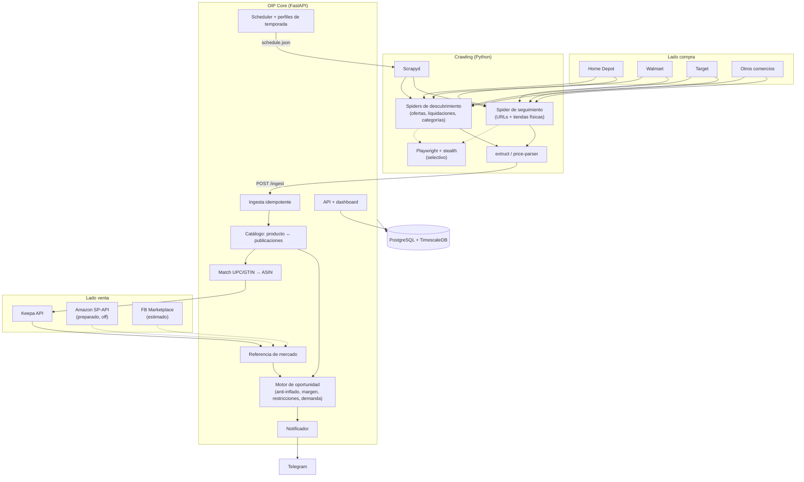
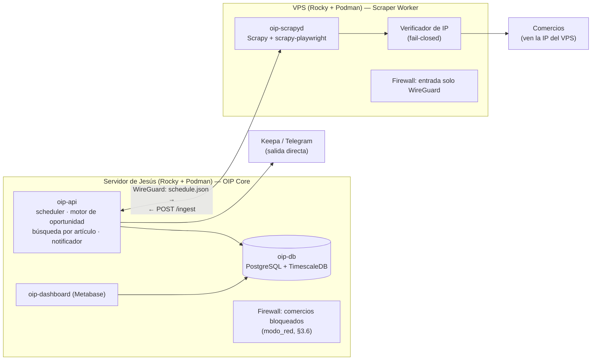
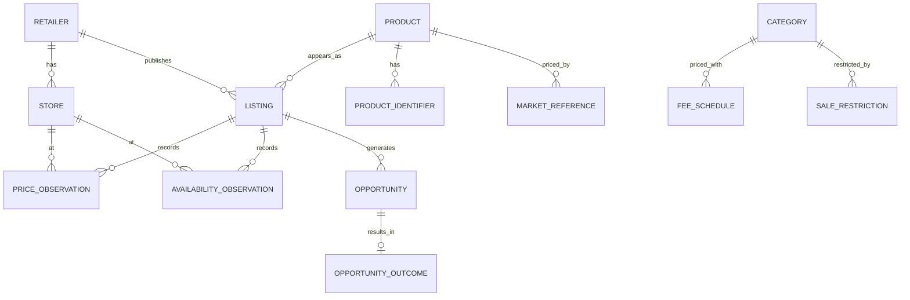

# Offer Intelligence Platform (OIP)

## Propuesta de alcance, auditoría de repositorios Open Source y arquitectura técnica

**Versión:** 1.3 — dos funcionalidades (búsqueda automatizada y búsqueda por artículo), topología Core/Worker, consulta responsable y alineación con las reglas de negocio (sobre v1.2, sin eliminar contenido: lo modificado se marca *(v1.3)* y conserva la redacción anterior)
**Fecha:** 9 de noviembre de 2026 (v1.3) · v1.2: 8 de noviembre de 2026
**Estado:** Línea base aprobada para construcción por incrementos; decisiones marcadas "PoC" se cierran con datos
**Tipo de producto:** Herramienta interna, uso propio, operación todo el año
**Idioma:** Español

> **Archivo vigente.** La arquitectura vive en un solo archivo; GitHub guarda el historial. Las versiones anteriores se consultan con estos enlaces permanentes (apuntan a un commit fijo y no cambian):
>
> | Versión | Fecha | Dónde |
> |---|---|---|
> | **v1.3** (vigente) | 2026-11-09 | Este archivo · [enlace permanente](https://github.com/jjrm2004mx/Offer-Intelligence-Platform-OIP/blob/a13c81801642f5ac49958fa92a9fd65e425b5948/docs/arquitectura/OIP_Arquitectura_Tecnica_Integrada_v1.3.md) |
> | v1.2 | 2026-11-08 | [enlace permanente](https://github.com/jjrm2004mx/Offer-Intelligence-Platform-OIP/blob/a13c81801642f5ac49958fa92a9fd65e425b5948/docs/arquitectura/OIP_Arquitectura_Tecnica_Integrada_v1.2.md) |
> | v1.1 y v1.0 | 2026-11-08 | Fuera del repo: documentos del proyecto en Claude y carpeta OIP del Drive (la v1.0 en `otros/`) |

> **Convención de certeza** (se conserva de v1.0): **Verificado** = observado en código/documentación;
> **Propuesta** = decisión arquitectónica recomendada; **PoC** = no se da por resuelto hasta probarlo.

---

## 0. Cambios respecto a v1.0

| # | Cambio | Motivo |
|---|---|---|
| C-01 | **Oportunidad comercial = margen de reventa**, validado contra precio de mercado, no contra el descuento anunciado. | Definición confirmada. Un 90% de descuento declarado puede ser falso o irrelevante. |
| C-02 | Se agrega todo el **lado de venta**: referencia de mercado (Amazon vía Keepa), match por UPC/GTIN, comisiones, restricciones, demanda. | v1.0 solo diseñaba la compra. |
| C-03 | Se agrega **tienda física** (radio San Diego) con inventario por sucursal y **costo de traslado** en el margen. | Muchas liquidaciones fuertes son solo en tienda. |
| C-04 | Núcleo en **Python (FastAPI)** en lugar de Java/Spring Boot. | Java no es requisito; un solo lenguaje para núcleo y crawling. |
| C-05 | **PriceGhost descartado.** | Sin commits desde 2-feb-2026, 2 autores, sin archivo LICENSE (solo "MIT" en README). |
| C-06 | **PriceStalker sale del núcleo**; queda como candidato opcional detrás de un adaptador, fijado en v2.0.0. | Joven (ene-2026), alta rotación (main en 2.2.0-beta), runtime Node adicional, doble extracción de precio. |
| C-07 | **Capacidad anti-bot (stealth) es requisito**; se elimina "no evadir controles" del fuera de alcance y se registra como riesgo aceptado. | Decisión del dueño del producto. |
| C-08 | **Un solo motor de navegador** (Playwright). | Elimina el segundo runtime (Puppeteer). |
| C-09 | **RabbitMQ y changedetection.io pasan a fase posterior.** Scrapyd + ingesta REST en el arranque. | Volumen inicial no lo justifica. |
| C-10 | Alertas por **Telegram** desde el primer incremento, además del dashboard. | Las ofertas fuertes duran horas. |
| C-11 | Despliegue en **Rocky Linux + Podman rootless con Quadlets** (systemd). | Plataforma objetivo. |
| C-12 | Se agregan OSS de apoyo: **extruct, price-parser, Spidermon, Scrapyd**. | Atacan directamente R-01, R-02, R-03 de v1.0. |
| C-13 | Correcciones editoriales: numeración duplicada en §20, formatos de tabla mixtos, inconsistencia changedetection "si se incorpora" vs ADR-010. | — |
| C-14 | Logística/costos transfronterizos de venta **fuera del modelo**. | Decisión del dueño del producto. |
| C-15 | *(v1.2)* **Rentabilidad ajustada por tiempo**: días de venta, ROI anualizado, riesgo de caída, devoluciones, unidades. | Rentabilidad real, no aparente. |
| C-16 | *(v1.2)* **Confianza del dato de tienda**, antigüedad, re-consulta previa al viaje, registro de visitas. | La disponibilidad no es inventario garantizado. |
| C-17 | *(v1.2)* **Acceso por fuente** con escalera; stealth apagado por defecto (reemplaza C-07). | Decisión por fuente con datos. |
| C-18 | *(v1.2)* **Egress obligatorio** (VPS → proxy), fail-closed; IP doméstica nunca expuesta. | Requisito duro del dueño del producto. |
| C-19 | *(v1.2)* **Puppeteer como motor alternativo por fuente** detrás de una interfaz de renderizado; se construye solo si la PoC-A lo justifica (matiza C-08). | Algunos comercios pueden detectar un motor y no el otro. |
| C-20 | *(v1.3)* **Dos funcionalidades** con un mismo motor de adquisición: **A. búsqueda automatizada** (reventa) y **B. búsqueda particular por artículo** (servicio a clientes; en el Inc. 1 la captura Jesús). | Retroalimentación del experto (DEC-110 a DEC-114). |
| C-21 | *(v1.3)* **Topología Core local + Scraper Worker remoto** (configurable; solo el worker remoto se construye). Precisa §3.4: la consulta nace en el VPS. | DEC-120. |
| C-22 | *(v1.3)* **Consulta responsable**: límites por dominio, pausas, concurrencia 1, caché, reintentos con espera creciente, timeouts y pausa por bloqueo (nueva §3.5). | DEC-115, RN-010. |
| C-23 | *(v1.3)* **Modo de red de la PoC** (`modo_red: estricto \| desarrollo`) con lista permitida y bloqueo de comercios desde casa por firewall (nueva §3.6). | DEC-121. |
| C-24 | *(v1.3)* **Infraestructura de referencia** del VPS y costos (por verificar); Rocky + Podman también en el VPS. | DEC-118, DEC-119. |
| C-25 | *(v1.3)* **Alineación con las RN** (prevalecen en reglas de negocio): rendimiento mensual en vez de ROI anualizado, niveles por mínimos, precio de venta conservador sin ajuste por competencia, `MARKET_ALREADY_CHEAP` sin condición del 50%, viaje fuera del margen por unidad. | DEC-028; RN-001 a RN-009. |
| C-26 | *(v1.3)* Sugerencias técnicas del experto **no adoptadas**: Java/Spring Boot y Ubuntu + Docker. | DEC-118. |

---

## 1. Resumen ejecutivo

OIP es una herramienta interna que **detecta productos que se pueden comprar muy por debajo de su precio real de mercado y revender con margen**. Funciona todo el año, con picos de temporada (Buen Fin, Black Friday, Navidad, regreso a clases, liquidaciones de fin de temporada).

El flujo central:

> **Descubrir ofertas** (online y en tienda física) → **identificar el producto** (UPC/GTIN → ASIN) →
> **obtener su precio real de mercado y demanda** (Amazon/Keepa + otros comercios + historial propio) →
> **descartar descuentos inflados** → **calcular margen neto** (incluyendo comisiones y traslado) →
> **filtrar restricciones** → **alertar** las que superen el umbral.

*(v1.3)* OIP tiene **dos funcionalidades** que comparten el mismo motor de adquisición (API · HTTP · navegador) y los mismos controles de consulta responsable:

| | Funcionalidad | Disparo | Resultado | Reglas |
|---|---|---|---|---|
| **A** | Búsqueda automatizada de ofertas (reventa) | Periódica (scheduler) | Oportunidades con nivel y alertas | RN-001 a RN-009 |
| **B** | Búsqueda particular por artículo (servicio a clientes) | Bajo demanda: Jesús captura la solicitud del cliente | Alternativas ordenadas: la más económica entre las disponibles | RN-011 |

Ambas respetan RN-010 (consulta responsable). *(v1.3)* Topología: **OIP Core** en el servidor de Jesús y **Scraper Worker** en un VPS (§3.4, §9).

Stack: Python (FastAPI + Scrapy + Playwright), PostgreSQL/TimescaleDB, Keepa API, Telegram, desplegado con Podman Quadlets en Rocky Linux. Unos 5–6 contenedores en el primer incremento.

---

## 2. Definición de oportunidad comercial

### 2.1 Las tres métricas

| Métrica | Fórmula | Uso |
|---|---|---|
| **Descuento declarado** | `1 − precio_oferta / precio_antes_comercio` | Solo para **descubrir candidatos**. No decide nada. |
| **Descuento real** | `1 − precio_oferta / precio_referencia_mercado` | Decide si de verdad está barato. |
| **Margen neto** | `precio_venta_esperado − costo_total_adquisición − costo_venta` | Decide si conviene comprarlo. |

Donde:

```
costo_total_adquisición = precio_oferta + impuesto_venta + costo_traslado (tienda física) + costo_envío_a_mí (online)
# (v1.3) Alineado con RN-001/RN-008: el costo_traslado NO entra en el margen por unidad;
#        se evalúa por viaje completo (RN-008). Por unidad: precio + impuesto + envío hacia mí.
costo_venta             = comisión_canal + envío_al_cliente (FBM) + empaque + otros_costos_venta (default 0)
margen_neto_%           = margen_neto / costo_total_adquisición
```

### 2.2 Precio de referencia de mercado

Se calcula con varias fuentes y se guarda cuál se usó:

1. **Amazon — precio habitual:** mediana de 90 días del precio Buy Box / nuevo (Keepa).
2. **Amazon — precio actual** (Keepa; SP-API cuando haya cuenta de vendedor).
3. **Otros comercios seguidos por OIP:** precio vigente del mismo producto en Walmart/Target/HD/etc.
4. **Historial propio del comercio que oferta:** mediana de los últimos 60 días en ese comercio.

`precio_referencia_mercado` = mínimo razonable entre (1) y (3) — el precio al que el comprador final puede conseguirlo hoy. `precio_venta_esperado` = (1) ajustado por competencia actual (número de vendedores, Buy Box).

> *(v1.3, alineado con RN-002)* `precio_referencia_mercado` = **el más bajo** entre (2) Amazon hoy, (1) mediana de 90 días y (3) otros comercios con dato ≤ 48 h. `precio_venta_esperado` = **el más bajo entre (2) y (1)**, sin ajuste por competencia (la competencia se evalúa en la demanda, RN-004). Sin oferta de Amazon hoy: se usa la mediana y la evaluación va a revisión manual (REQ-2026-0001 §3.3).

### 2.3 Reglas anti-descuento inflado (Verificables con datos propios)

| Flag | Regla | Efecto |
|---|---|---|
| `INFLATED_WAS_PRICE` | `precio_antes_comercio` > 1.5 × mediana 60 días del propio comercio | Se ignora el descuento declarado |
| `MARKET_ALREADY_CHEAP` | descuento real < 20% aunque el declarado sea ≥ 50% · *(v1.3, RN-003: descuento real < 20%, **sin** condición sobre el declarado)* | Descartada (caso "lámpara") |
| `NO_MARKET_REFERENCE` | sin match en Amazon ni en otros comercios | A revisión manual, no alerta |
| `LOW_MATCH_CONFIDENCE` | match por título/similitud, sin UPC/GTIN | A revisión, no alerta automática |

**Ejemplo (lámpara):** Walmart anuncia antes $200, ahora $20 (90% declarado). Amazon la vende habitualmente en $22. Descuento real 9%, margen negativo tras comisión → `MARKET_ALREADY_CHEAP`, descartada.

### 2.4 Niveles (configurables)

Aplicados sobre **descuento real**, con margen neto mínimo y demanda mínima:

| Nivel | Descuento real | Margen neto mínimo | Acción |
|---|---|---|---|
| 🔴 Excepcional | ≥ 80% | ≥ 50% y ≥ $X | Alerta inmediata Telegram |
| 🟠 Muy buena | 70–79% | ≥ 40% | Alerta inmediata |
| 🟡 Buena | 50–69% | ≥ 30% | Resumen periódico |
| ⚪ Interesante | 40–49% | ≥ 25% | Solo dashboard |

Valores iniciales; se calibran con datos reales. `$X` = margen absoluto mínimo para que valga el esfuerzo (traslado, tiempo).

> *(v1.3, alineado con RN-009)* Los niveles se definen por **mínimos** (no por rangos): se asigna **el nivel más alto cuyas dos condiciones se cumplan** (descuento real ≥ X y margen **ajustado** ≥ Y). Mínimo absoluto: **$10 por unidad**. Avisos: Excepcional y Muy buena inmediatos; Buena en resumen (8:00 y 18:00); Interesante solo en el tablero.

### 2.5 Demanda ("lo que la gente mueve")

- **Ranking de ventas Amazon (BSR)** actual y tendencia 30/90 días (Keepa).
- Número de ofertas/vendedores activos (saturación).
- Umbral de BSR por categoría (configurable). Un producto barato que nadie compra no es oportunidad.

### 2.5.1 Rentabilidad ajustada por tiempo

Un margen alto que tarda meses en venderse puede valer menos que uno moderado que se vende en días. Se agregan:

| Métrica | Cálculo | Uso |
|---|---|---|
| `dias_estimados_venta` | Función de BSR, número de vendedores y unidades a vender (Keepa) | Estimado, se calibra con `opportunity_outcome` |
| `roi_anualizado` | `margen_neto_% × (365 / dias_estimados_venta)` | **Ordena** las oportunidades |
| `riesgo_caida_precio` | Volatilidad del precio Amazon 90 días | Penaliza el margen esperado |
| `unidades_recomendadas` | Máximo vendible en N días según demanda | Evita sobrecomprar |
| `tasa_devolucion` | % configurable por categoría | Se descuenta del margen |

`margen_neto_ajustado = margen_neto − (precio_venta_esperado × tasa_devolucion) − (precio_venta_esperado × riesgo_caida_precio)`

Los niveles de §2.4 se evalúan sobre `margen_neto_ajustado`; el dashboard y las alertas se ordenan por `roi_anualizado`.

> *(v1.3, alineado con RN-005)* Se reemplaza `roi_anualizado` por **`rendimiento_mensual` = margen ajustado % × 30 ÷ días para recuperar** (días de venta según ranking 7/21/45 + 14 días de pago de Amazon). Fórmula vigente del margen ajustado: `margen_neto − (precio_venta_esperado × tasa_devolucion × pérdida_por_devolución) − (precio_venta_esperado − mínimo_90d) × 50%`; sin mínimo de 90 días, castigo = 10% del precio de venta esperado. Unidades recomendadas = ventas al mes ÷ (vendedores + 1), con tope.

### 2.6 Restricciones de venta

Antes de alertar, marcar:

- Categorías/marcas que requieren aprobación en Amazon (joyería y relojes suelen requerirla — **confirmar en Seller Central**).
- Posible clasificación de materiales peligrosos/hazmat (perfumes, aerosoles, baterías) — **confirmar**.
- Productos restringidos por marca.

Sin cuenta de vendedor: tabla manual configurable. Con cuenta: adaptador SP-API (ya preparado, desactivado).

---

## 3. Alcance

### 3.1 Dentro del alcance

| Dimensión | Alcance |
|---|---|
| Operación | Todo el año; perfiles de temporada (frecuencia mayor en Buen Fin, Black Friday, Navidad, liquidaciones). |
| Comercios | Arranque: **Home Depot, Walmart, Target**. Después: otros comercios reconocidos por categoría. Cada comercio = conector configurable. |
| Categorías | Herramientas (prioridad), hogar/iluminación, tecnología, juguetes, relojes, joyería, perfumes. Abierto: cualquier categoría "que se mueva". |
| Canales de compra | **Online** y **tienda física** en radio configurable (inicial: zona San Diego). Más allá, solo si el margen absoluto lo justifica. |
| Canales de venta | **Amazon FBM** (referencia principal) y **Facebook Marketplace** (precio estimado, fase posterior). |
| Notificación | Telegram + dashboard. |
| *(v1.3)* Funcionalidades | **A.** Búsqueda automatizada de ofertas (reventa). **B.** Búsqueda particular por artículo, servicio a clientes: en el Inc. 1 el cliente pide a Jesús y Jesús captura en OIP; la solicitud directa del cliente (p. ej. WhatsApp) es futura. |
| *(v1.3)* Comercios para la búsqueda por artículo | Home Depot, Walmart y Amazon (precio de nuevo vía Keepa); ampliable. |
| Seguimiento | Precio, disponibilidad (online y por tienda), historial. |
| Administración | Comercios, tiendas, categorías, frecuencias, umbrales, tabla de comisiones/restricciones. |

### 3.2 Fuera del alcance (por ahora)

- Compra automática / carrito / checkout.
- Publicación automática en Amazon o Facebook (fase futura; el adaptador de Amazon queda preparado).
- Resolver CAPTCHA mediante servicios de terceros (se registra el bloqueo y se reintenta más tarde).
- Sesiones con cuentas personales de las tiendas.

### 3.3 Acceso a comercios: decisión por fuente

La capacidad stealth existe en la capa de navegador, pero **está apagada por defecto en todas las fuentes**. Cada fuente tiene un `access_mode` y sube la escalera solo con datos:

| Escalón | `access_mode` | Cuándo |
|---|---|---|
| 0 | `api_feed` | Existe API/feed/sitemap utilizable (p. ej. API de afiliados de Walmart — confirmar acceso y datos) |
| 1 | `http` | Página entrega los datos sin JavaScript |
| 2 | `browser` | Requiere renderizado; navegador normal |
| 3 | `browser_stealth` | Solo si la tasa de bloqueo medida inutiliza la fuente **y** no hay alternativa en escalones 0–2 |

Reglas:

- Subir a `browser_stealth` es un **cambio manual de configuración** del dueño del producto, registrado con fecha y motivo; el sistema mide la tasa de bloqueo antes/después.
- Si el bloqueo supera el umbral incluso en el escalón 3, la fuente **se pausa sola** y avisa por Telegram.
- Frecuencias conservadoras por dominio y jitter; backoff automático.
- Métrica de **tasa de bloqueo por fuente y escalón** desde el día uno.
- Riesgo aceptado para fuentes en escalón 3: posible incumplimiento de términos de uso (ver R-09).

### 3.3.1 Motor de navegador por fuente

Los spiders no invocan un navegador concreto: piden el renderizado a una interfaz `BrowserRenderer`. El motor se elige por fuente con `browser_engine`:

- **`playwright`** (por defecto): integrado en los workers Scrapy vía scrapy-playwright.
- **`puppeteer`** (alternativa): servicio Node.js aparte (`oip-renderer-puppeteer`) que recibe la URL por HTTP y devuelve el HTML. Su tráfico también sale solo por `oip-egress`.

El servicio Puppeteer **no se construye en el arranque**; se construye solo si la PoC-A encuentra una fuente que pasa con Puppeteer y no con Playwright. La escalera de acceso (§3.3) aplica igual con cualquier motor.

### 3.4 Protección de la IP doméstica (requisito duro)

**La IP de la casa nunca debe usarse para scraping.** Esto se garantiza por topología de red, no por configuración:

- Los contenedores de crawling viven en una red Podman **interna sin salida a Internet**. Su única ruta es el contenedor `oip-egress`.
- `oip-egress` envía el tráfico por **WireGuard a un VPS** (MVP) o a un **proveedor de proxies** (volumen). Cambiar de uno a otro es configuración del egress, sin tocar spiders.
- **Fail-closed:** si el túnel/proxy cae, los spiders quedan sin conectividad. Nunca hay fallback a la conexión directa.
- **Verificación al arrancar cada job:** el spider consulta su IP pública; si coincide con la IP doméstica registrada (o falla la verificación), aborta el job y alerta.
- Tráfico a APIs legítimas (Keepa, Telegram, SP-API) sí sale directo desde `oip-api`.
- Navegador bloquea imágenes, fuentes y media para reducir consumo (relevante con proxies de pago por GB).
- **Etapas:** MVP con VPS barato (IPs de datacenter, más propensas a bloqueo — se mide); volumen con proxies residenciales de pago por GB por fuente según necesidad.
- El experimento de bloqueo (spike) corre por el egress desde su primera ejecución.

#### 3.4.1 *(v1.3)* Topología Core local + Scraper Worker remoto (DEC-120)

Precisa lo anterior: en lugar de correr el scraping en casa y redirigir su tráfico por un túnel, **el scraping corre en el VPS**. La casa nunca habla con los comercios.

| Pieza | Dónde | Contiene |
|---|---|---|
| **OIP Core** | Servidor de Jesús (Rocky + Podman) | `oip-api` (FastAPI, scheduler, motor de oportunidad, búsqueda por artículo, notificador), `oip-db`, `oip-dashboard`, `oip-backup` |
| **OIP Scraper Worker** | VPS (Rocky + Podman) | `oip-scrapyd` (Scrapy + scrapy-playwright + Chromium), verificador de IP, firewall de salida |
| **Canal** | WireGuard Core ↔ Worker | Core → Worker: `schedule.json` de Scrapyd (trabajos). Worker → Core: `POST /ingest` (resultados). Solo por el túnel; ningún puerto expuesto a Internet salvo WireGuard en el VPS |

Reglas:
- **El Worker verifica su IP pública antes de cada job** y aborta si no es la IP autorizada del VPS (fail-closed).
- El firewall del VPS permite salida HTTPS a los comercios y entrada **solo** por WireGuard. Scrapyd no escucha en la interfaz pública.
- Autenticación del canal: claves WireGuard + token por servicio en `schedule.json` e `/ingest` (secreto en `podman secret`).
- **Configurable:** el Core usa una sola interfaz (`ACQUISITION_WORKER_URL` + endpoint de ingesta), así que el Worker puede vivir en el VPS o en casa detrás de `oip-egress`. **Solo se construye y opera el modo worker remoto**; el modo túnel (lo descrito arriba en esta sección) queda **documentado y sin construir**.
- Escalamiento futuro: más Workers o un Worker detrás de proxies residenciales (DEC-117) sin tocar el Core.

### 3.5 *(v1.3)* Consulta responsable (DEC-115, RN-010)

| Control | Implementación (Scrapy / Core) | Valor inicial |
|---|---|---|
| Límite de consultas | `CONCURRENT_REQUESTS_PER_DOMAIN=1` + `DOWNLOAD_DELAY` y limitador por dominio en el Worker | ≤ 6 por minuto por comercio |
| Pausa (throttling) | `DOWNLOAD_DELAY=10` con `RANDOMIZE_DOWNLOAD_DELAY` ajustado al rango 10–15 s; AutoThrottle activado como techo adicional | 10–15 s |
| Concurrencia | 1 por comercio; comercios distintos en paralelo (`CONCURRENT_REQUESTS` global moderado) | 1 / comercio |
| Caché | En el Core, por publicación: 6 h (búsqueda automatizada), **1 h** (búsqueda por artículo); Keepa 6 h | 6 h / 1 h / 6 h |
| Reintentos | Cola de reintentos del Core con espera creciente; no se usa el reintento inmediato de Scrapy para errores de bloqueo | 3 intentos: 1, 5, 15 min |
| Timeout | `DOWNLOAD_TIMEOUT` (HTTP) y timeout de navegación (Playwright) | 30 s / 60 s |
| Pausa por bloqueo | Métrica por dominio en ventana de 1 h; si > 20% bloqueadas → `retailer_policy.estado = pausado` por 24 h y aviso | 20% / 24 h |
| robots.txt | `ROBOTSTXT_OBEY` configurable por comercio | **Pendiente** (pregunta RN-010 · P2) |

Postura (DEC-116): OIP no pretende ocultarse ni evadir restricciones; stealth deshabilitado por defecto (§3.3).

### 3.6 *(v1.3)* Modo de red para la prueba de concepto (DEC-121)

- `modo_red: estricto | desarrollo`, **estricto por defecto**.
- **Estricto:** toda consulta a comercios va al Worker en el VPS. El Core no tiene ruta de scraping propia.
- **Desarrollo:** permite ejecutar spiders en casa **solo** contra una lista permitida (fixtures guardados, simulaciones, APIs que permiten automatización).
- **Límite duro, independiente de la aplicación:** el firewall del servidor de Jesús (nftables / firewalld) **rechaza la salida hacia los dominios de Home Depot, Walmart y Target** desde los contenedores. Ninguna opción de OIP lo desbloquea.
- Activar el modo desarrollo deja un registro (quién y cuándo) y muestra un aviso visible en el tablero y en Telegram.

---

## 4. Auditoría Open Source revisada

### 4.1 Tabla de decisión

| Proyecto | Licencia | Rol en OIP | Decisión |
|---|---|---|---|
| **Scrapy** | BSD-3-Clause | Descubrimiento y seguimiento | **Adoptar** (núcleo) |
| **scrapy-playwright** | BSD-3-Clause | Renderizado + stealth en páginas dinámicas | **Adoptar** selectivo |
| **Scrapyd** | BSD-3-Clause (verificar) | Ejecutar spiders por API HTTP | **Adoptar** en arranque |
| **extruct** | BSD (verificar) | Leer JSON-LD/microdata schema.org (GTIN, precio, disponibilidad) | **Adoptar** |
| **price-parser** | BSD (verificar) | Parsear precios en texto | **Adoptar** |
| **Spidermon** | BSD (verificar) | Monitoreo de calidad de extracción | Incremento 2 |
| **PriceStalker** | MIT | Seguimiento alternativo | **Opcional**, PoC comparativa |
| **PriceGhost** | Sin LICENSE (solo README) | — | **Descartado** |
| **changedetection.io** | Apache-2.0 | Disparador de discovery por cambio | Incremento 3 |
| **TimescaleDB** | Apache-2.0 (core) / TSL (algunas funciones) | Series de tiempo de precios | **Adoptar** (uso interno sin problema) |
| **Keepa API** | Comercial | Referencia de mercado y demanda Amazon | **Adoptar** |
| **Amazon SP-API** | Comercial (requiere cuenta vendedor) | Comisiones exactas, restricciones | Adaptador preparado, desactivado |

### 4.2 PriceStalker — hallazgos verificados en código (8-nov-2026)

- Repo creado en enero 2026; 477 commits; **176 commits en últimos 90 días**.
- Mantenedores efectivos: ~3 (mikeknight85, stevene1919, clucraft como autor original).
- Única estable: **v2.0.0 (31-ago-2026)**; main en **v2.2.0-beta.2**. `version.json` dice `2.0.0-beta.1` (inconsistente con tags).
- Usa `puppeteer-extra-plugin-stealth` (`scraper/src/core/SessionManager.ts`).
- **Sí tiene webhooks**: proveedor de notificaciones con 6 eventos (baja de precio, precio objetivo, regreso a stock, no disponible, restaurado, anunciado). Son alertas, no cada observación; el historial completo requiere polling.
- Despliegue con Docker Compose; para Podman: `podman-compose` o `podman kube play` — PoC.
- La tabla de símbolos de moneda no incluye MXN (menor).

**Por qué sale del núcleo:** OIP ya necesita seguir precios con Scrapy (para el historial propio y la regla anti-inflado). Con PriceStalker el precio se extraería dos veces con dos motores, el historial quedaría duplicado en dos bases y se agrega Node + Puppeteer. Se conserva como **benchmark**: si en la PoC extrae precios notablemente mejor en algún comercio, se integra para ese comercio vía adaptador `TrackingProvider`.

### 4.3 Keepa

Servicio que registra desde hace años el historial de precio y ranking de ventas del catálogo de Amazon. Permite consulta por ASIN y por código (UPC/EAN).

- Plan de entrada reportado: **~49 €/mes, 20 tokens/min** (fuente de terceros; confirmar en keepa.com).
- 1 token por producto estándar, hasta 100 por llamada → ~28,000 consultas/día con el plan de entrada.
- Estrategia: **caché agresiva** en OIP (la referencia de mercado cambia lento); refrescar solo candidatos con descuento declarado relevante.

---

## 5. Arquitectura lógica



### 5.1 Responsabilidades

| Componente | Hace | No hace |
|---|---|---|
| Spiders de descubrimiento | Recorrer ofertas/liquidaciones/categorías; emitir candidatos con evidencia | Decidir identidad ni oportunidad |
| Spider de seguimiento | Re-extraer precio/stock de publicaciones seleccionadas; por tienda cuando aplica | Descubrir |
| Scrapyd | Ejecutar jobs de spiders por API | Planificar (lo hace OIP) |
| Ingesta | Validar esquema, dominio, canonicalizar URL, deduplicar | Llamar a Keepa en línea |
| Match | Ligar producto a ASIN por UPC/GTIN; similitud solo como auxiliar | Fusionar sin evidencia |
| Referencia de mercado | Consultar/cachear Keepa, consolidar precios de otros comercios | — |
| Motor de oportunidad | Aplicar §2 completo y asignar nivel | Comprar o publicar |
| Notificador | Telegram con deduplicación (no repetir la misma oferta) | — |

### 5.2 Ejecución asíncrona

Arranque: **Scrapyd** para spiders + **cola de tareas sobre PostgreSQL** (p. ej. Procrastinate) para enriquecimiento Keepa y cálculo de oportunidad. Sin broker adicional.
Migrar a RabbitMQ solo si hay más de un nodo de crawling o la cola en Postgres se vuelve cuello de botella.

### 5.3 *(v1.3)* Despliegue físico: Core local + Scraper Worker remoto



### 5.4 *(v1.3)* Flujos de las dos funcionalidades

**A. Búsqueda automatizada:** scheduler del Core → `schedule.json` (spider de descubrimiento/seguimiento) → Worker consulta comercios con los controles de §3.5 → `POST /ingest` → catálogo → match → Keepa → motor de oportunidad (RN-001 a RN-009) → alertas.

**B. Búsqueda por artículo:** Jesús captura la solicitud (`client_request`) en el Core → el Core busca primero en caché (≤ 1 h) → para lo que falte, `schedule.json` (spider de búsqueda por artículo, con prioridad sobre los trabajos periódicos pero con los mismos límites por comercio) + consulta a Keepa para Amazon → `POST /ingest` → ordenamiento de RN-011 (disponibles por precio total; el resto aparte) → resultado consultable y exportable para que Jesús responda al cliente.

---

## 6. Tienda física

### 6.1 Qué cambia

- Precio e inventario **por sucursal**, frecuentemente distintos del precio online.
- Los comercios exponen disponibilidad por tienda/código postal en su sitio; el spider de seguimiento debe consultar con la tienda seleccionada.
- Las liquidaciones más profundas a veces **no aparecen en línea** → cobertura parcial aceptada; se registra la fuente del dato.

### 6.2 Configuración de tiendas

Tabla `store` con: comercio, número de tienda, dirección, coordenadas, código postal, distancia y tiempo estimado desde el origen (Tijuana), activa/inactiva. Inicial: sucursales de HD, Walmart y Target en el área de San Diego (Chula Vista, National City, San Ysidro, San Diego, etc.).

### 6.3 Costo de traslado

```
costo_traslado = (km_ida_vuelta × costo_por_km)
               + (horas_totales × valor_hora)
               + costo_fijo_cruce
horas_totales  = tiempo_manejo + tiempo_cruce_frontera_estimado + tiempo_en_tienda
```

- Parámetros configurables: rendimiento, precio de gasolina, valor de tu hora, tiempo de cruce promedio.
- **Agrupación de viaje:** si hay varias oportunidades en la misma zona, el costo se prorratea → el dashboard muestra "ruta de compra" con margen total.
- Regla: tiendas fuera del radio solo alertan si `margen_neto_absoluto` ≥ umbral alto configurable.

### 6.3.1 Confianza del dato de disponibilidad en tienda

La disponibilidad en tienda **no es inventario garantizado**. Cada observación registra:

- `consultado_en` y antigüedad visible en toda alerta ("consultado hace 3 h").
- `confianza`:
  - **Alta:** cantidad numérica, consulta < N horas.
  - **Media:** solo "en stock" / "pocas unidades", o cantidad de antigüedad media.
  - **Baja:** dato antiguo o el comercio reporta "limited stock".
- **Decaimiento:** la confianza baja con las horas según la velocidad de agotamiento de la categoría.
- **Re-consulta previa al viaje:** botón en la alerta de Telegram que vuelve a consultar la tienda justo antes de salir.
- **Registro de visita** (encontrado / no encontrado / precio distinto) en `opportunity_outcome`, para calibrar confianza por tienda y comercio.
- Oportunidades de tienda física con confianza **baja** no generan alerta inmediata.

### 6.4 Logística de venta

Fuera del alcance del modelo de margen por decisión del dueño del producto: no se modelan costos de importación ni de cruce para la venta. El parámetro `otros_costos_venta` queda disponible por canal (default 0) por si se requiere un ajuste manual.

---

## 7. Modelo de datos

### 7.1 Entidades

| Entidad | Propósito |
|---|---|
| `retailer`, `retailer_domain` | Comercio y dominios autorizados |
| `store` | Sucursal física con ubicación y costo de traslado calculado |
| `category`, `retailer_source` | Taxonomía y URLs de entrada (ofertas, liquidaciones, categorías) |
| `product` | Identidad canónica |
| `product_identifier` | UPC/GTIN/EAN, MPN, SKU comercio, **ASIN** |
| `listing` | Publicación de un producto en un comercio (online) |
| `price_observation` *(hypertable)* | Precio con fecha, moneda, tipo (oferta/regular/liquidación), `store_id` opcional |
| `availability_observation` *(hypertable)* | Stock online o por tienda, con `consultado_en`, `confianza` y fuente |
| `store_visit` | Resultado de cada visita a tienda (encontrado/no encontrado/precio distinto) |
| `market_reference` *(hypertable)* | Snapshot de referencia: fuente (keepa/otro comercio/historial), precio, BSR, vendedores, ventana |
| `fee_schedule` | Comisión por canal y categoría (manual; SP-API cuando exista) |
| `sale_restriction` | Categoría/marca restringida o hazmat por canal |
| `opportunity` | Resultado del motor: métricas (incl. `margen_neto_ajustado`, `roi_anualizado`, `dias_estimados_venta`, `unidades_recomendadas`), flags, nivel, estado (nueva/alertada/descartada/comprada/vendida) |
| `opportunity_outcome` | Resultado real: precio de compra, precio de venta, días para vender → **calibra el motor** |
| *(v1.3)* `client_request` | Solicitud de búsqueda por artículo: alias del cliente (sin datos personales), descripción, modelo/UPC, cantidad, notas, fecha, estado |
| *(v1.3)* `client_request_result` | Opciones encontradas por solicitud: comercio/sucursal, precio, envío, total, disponibilidad, confianza, consultado_en, enlace, grupo (disponible / otras), posición, recomendada |
| *(v1.3)* `fetch_log` | Registro por consulta a comercio: dominio, hora, resultado (ok / error / bloqueada), duración; alimenta los límites y la pausa por bloqueo (§3.5) |
| *(v1.3)* `network_mode_change` | Cambios de `modo_red` (quién, cuándo, motivo) (§3.6) |
| `crawl_job`, `extraction_evidence` | Trazabilidad |
| `retailer_policy` | Frecuencia, límites, perfil de temporada, `access_mode`, `browser_engine` (`playwright` \| `puppeteer`), egress asignado, estado de bloqueo |
| `access_mode_change` | Historial de cambios de escalón por fuente (fecha, motivo, tasa de bloqueo antes/después) |

`opportunity_outcome` es clave: con lo que realmente compres y vendas se ajustan umbrales y estimados.

### 7.2 Diagrama ER conceptual



### 7.3 Identidad y match

1. UPC/GTIN/EAN válido (dígito verificador) — preferente; extraído de JSON-LD con extruct.
2. MPN + marca.
3. Búsqueda Keepa por código.
4. Título + marca + atributos (solo auxiliar; marca `LOW_MATCH_CONFIDENCE`).

Corrección manual desde el dashboard con trazabilidad.

### 7.4 Volumen y retención

`price_observation` y `market_reference` como hypertables TimescaleDB con compresión a partir de 30 días y agregados continuos diarios. Retención de detalle: 1 año; agregados: indefinido.

---

## 8. Contrato de ingesta (Scrapy → OIP)

```json
{
  "schemaVersion": "1.1",
  "crawlJobId": "uuid",
  "retailerCode": "homedepot",
  "storeCode": "hd-0123",
  "sourceType": "clearance",
  "sourceUrl": "https://...",
  "productUrl": "https://...",
  "title": "...",
  "brand": "...",
  "model": "...",
  "retailerSku": "...",
  "gtin": "0123456789012",
  "price": { "current": 19.97, "was": 199.00, "currency": "USD", "type": "clearance" },
  "availability": { "status": "in_stock", "quantity": 4, "scope": "store" },
  "extractedAt": "2026-11-08T18:00:00Z",
  "extractionMethod": "playwright_jsonld",
  "blocked": false,
  "evidence": { "jsonld": true, "priceSelector": "..." }
}
```

Idempotencia: `retailer + canonical_url + store_code + extractedAt (truncado a ventana)`. `blocked: true` alimenta la métrica de bloqueo sin generar observación.

---

## 9. Despliegue (Rocky Linux + Podman rootless)

### 9.1 Contenedores del incremento 1

| Contenedor | Imagen base |
|---|---|
| `oip-api` | Python 3.12 + FastAPI + workers de tareas |
| `oip-scrapyd` | Python 3.12 + Scrapy + scrapy-playwright + Chromium |
| `oip-db` | PostgreSQL + TimescaleDB |
| `oip-dashboard` | Metabase (lectura sobre la BD) en incremento 1; UI propia en incremento 2 |
| `oip-backup` | Job de respaldo (`pg_dump` programado) |
| `oip-egress` | Cliente WireGuard hacia VPS (MVP) o proxy (volumen); única salida de `oip-scrapyd` (y de `oip-renderer-puppeteer` si existe) |
| `oip-renderer-puppeteer` | *Condicional.* Servicio Node.js que recibe "renderiza esta URL" por HTTP y devuelve HTML; solo se despliega si la PoC-A lo justifica. Vive en `oip-internal` |

Redes Podman: `oip-internal` (sin salida; `oip-scrapyd`, `oip-egress`, `oip-api`, `oip-db`) y `oip-public` (`oip-api`, `oip-egress`, dashboard). `oip-scrapyd` **no** está en `oip-public`. Detalle en §3.4.

> *(v1.3, DEC-120)* **Topología vigente: worker remoto.** Los contenedores se reparten en dos hosts:
>
> | Host | Contenedores |
> |---|---|
> | **Servidor de Jesús (Core)** | `oip-api`, `oip-db`, `oip-dashboard`, `oip-backup`, endpoint WireGuard |
> | **VPS (Worker)** | `oip-scrapyd` (Scrapy + scrapy-playwright + Chromium), verificador de IP, endpoint WireGuard; firewall de salida |
>
> `oip-egress` y la red `oip-internal` descritas arriba corresponden al **modo túnel** (worker en casa), que queda **documentado y sin construir**. En el modo worker remoto, la salida a los comercios es la IP pública del VPS, y la casa no tiene ninguna ruta de scraping.
>
> **Infraestructura de referencia del VPS (DEC-119, precios por verificar antes de contratar):** proveedor tipo Hetzner, DigitalOcean o Vultr; referencia del experto: ~USD 6.49/mes (2 vCPU / 4 GB) + ~USD 0.60/mes de IPv4. **Recomendado para navegadores: 4 vCPU / 8 GB.** Sistema: **Rocky Linux + Podman** (DEC-118), no Ubuntu + Docker. Monitoreo de disponibilidad del Worker desde el Core (heartbeat por WireGuard).

### 9.2 Operación

- **Quadlets** (`.container`, `.network`, `.volume`) gestionados por `systemd --user`, con `loginctl enable-linger`.
- Red Podman privada; solo el dashboard/API expuestos detrás de reverse proxy con TLS (o solo VPN/Tailscale, por ser herramienta interna).
- Secretos con `podman secret` (Keepa key, token Telegram, credenciales BD).
- Desarrollo local: `podman-compose`.
- PriceStalker (si se prueba): `podman kube play` sobre su compose convertido, en red separada — PoC.

---

## 10. Seguridad y operación

Se conservan de v1.0: validación de URL y protección SSRF (solo http/https, dominio del comercio, bloqueo de rangos privados y metadata, revalidar redirecciones), secretos fuera de código, logs sin tokens, BD sin exposición.

### 10.1 Observabilidad mínima

- Tasa de éxito y **tasa de bloqueo por comercio**.
- Candidatos/día por comercio y fuente; % con GTIN; % con match a ASIN.
- Consumo de tokens Keepa vs presupuesto.
- Oportunidades por nivel; % descartadas por `INFLATED_WAS_PRICE` / `MARKET_ALREADY_CHEAP`.
- Antigüedad de la última observación por publicación.
- **Precisión del motor**: de las oportunidades que compraste, % que se vendieron con el margen estimado (desde `opportunity_outcome`).

Herramienta: logs estructurados + métricas en Postgres visibles en Metabase; Prometheus/Grafana solo si se requiere después.

---

## 11. Riesgos

| ID | Riesgo | Impacto | Mitigación |
|---|---|---|---|
| R-01 | Bloqueos anti-bot (HD/Walmart/Target usan protecciones comerciales agresivas) | Crítico | Stealth, frecuencia conservadora, métrica de bloqueo, pausa automática, proxies si se justifica |
| R-02 | Descuento inflado tomado como oportunidad | Alto | Reglas §2.3 + historial propio |
| R-03 | Match incorrecto producto ↔ ASIN | Alto | GTIN preferente; baja confianza no alerta |
| R-04 | Precio en tienda distinto al online / liquidación no visible | Alto | Seguimiento por tienda; fuente registrada; cobertura parcial aceptada |
| R-05 | Restricciones de venta no detectadas | Alto | Tabla de restricciones; SP-API cuando haya cuenta |
| R-07 | Cambios de HTML rompen spiders | Alto | JSON-LD primero, Spidermon, pruebas por comercio |
| R-08 | Costo Keepa crece | Medio | Caché, refresco solo de candidatos, presupuesto de tokens |
| R-09 | Términos de uso de los sitios | Medio/alto (aceptado) | Uso interno, frecuencia baja, sin datos personales |
| R-10 | Fugas de memoria del navegador | Medio | Límites de contextos, reciclaje, métricas |
| R-17 | Un comercio detecta el motor de navegador en uso | Alto | Interfaz de renderizado con motor por fuente; PoC-A compara Playwright vs Puppeteer |
| R-18 | *(v1.3)* El VPS (Worker) no está disponible | Alto | Sin respaldo desde casa (fail-closed); heartbeat y aviso; trabajos en cola hasta que vuelva |
| R-19 | *(v1.3)* Canal Core ↔ Worker expuesto o comprometido | Crítico | Solo WireGuard; Scrapyd sin interfaz pública; token por servicio; firewall de entrada |
| R-20 | *(v1.3)* Datos de clientes (búsqueda por artículo) | Medio | Solo alias, sin datos personales; respaldo cifrado |
| R-21 | *(v1.3)* Pocas o ninguna opción disponible para un cliente | Medio | Mostrar "otras opciones" y aviso de repetir la búsqueda (RN-011) |
| R-11 | SSRF desde URLs descubiertas | Crítico | §10 |
| R-12 | Alertas repetidas/ruido | Medio | Deduplicación por oportunidad y ventana |
| R-13 | **IP doméstica marcada o bloqueada** | Crítico | Egress obligatorio, red interna sin salida, fail-closed, verificación de IP por job (§3.4) |
| R-14 | IP del VPS (datacenter) bloqueada | Alto | Medir; cambiar egress de esa fuente a proxy residencial |
| R-15 | Rentabilidad aparente (margen alto, rotación lenta) | Alto | Margen ajustado y ROI anualizado (§2.5.1) |
| R-16 | Viaje a tienda sin producto | Medio | Confianza del dato, re-consulta previa, registro de visitas (§6.3.1) |

---

## 12. Plan por incrementos

### Incremento 1 — "Primera oportunidad real"

- Conectores: **Home Depot** (ofertas + liquidaciones, online + tiendas San Diego) y **Walmart** (ofertas online).
- Extracción JSON-LD + Playwright stealth selectivo.
- Match GTIN → ASIN vía Keepa; referencia de mercado y BSR.
- Motor de oportunidad completo (§2) con tabla de comisiones manual.
- Alertas Telegram + Metabase.
- *(v1.3)* **Búsqueda por artículo** (funcionalidad B, RN-011): captura por Jesús, búsqueda en Home Depot, Walmart y Amazon, resultado ordenado.
- *(v1.3)* **Consulta responsable** (RN-010) y **topología Core local + Worker en VPS**.
- Despliegue con Quadlets en Rocky.

**Criterio de salida:** al menos una oportunidad real validada a mano por semana con margen ≥ umbral; tasa de bloqueo medida por comercio.

### Incremento 2 — "Cobertura"

- **Target** y comercios adicionales por categoría (perfumes, relojes, joyería, juguetes).
- Costo de traslado y rutas de compra agrupadas.
- Restricciones de venta; `opportunity_outcome` y calibración de umbrales.
- Spidermon; UI propia del dashboard (FastAPI + HTMX o React).
- Perfiles de temporada.

### Incremento 3 — "Venta"

- Facebook Marketplace (precio estimado y luego observado).
- Activar SP-API (cuando exista cuenta de vendedor): comisiones exactas, restricciones, y base para publicación.
- changedetection.io como disparador sobre páginas de liquidación.
- RabbitMQ si hay multi-nodo; proxies si la tasa de bloqueo lo exige.

### PoCs (antes/durante incremento 1)

| PoC | Pregunta | Criterio |
|---|---|---|
| PoC-A | ¿Qué escalón de acceso y qué motor (Playwright vs Puppeteer, script Node desechable) necesitan HD y Walmart, siempre vía `oip-egress`? | Tasa de bloqueo por escalón y motor medida 7 días; IP doméstica nunca aparece |
| PoC-B | ¿Qué % de candidatos trae GTIN y hace match con ASIN en Keepa? | ≥ 60% en herramientas |
| PoC-C | ¿El inventario por tienda de HD es consultable de forma confiable? | Datos por tienda coinciden con visita/llamada |
| PoC-D | Spider de seguimiento vs PriceStalker v2.0.0 sobre las mismas 50 URLs | Decide si PriceStalker entra (por comercio) |

> *(v1.3)* La PoC-A se ejecuta desde el **Worker en el VPS** (DEC-120/121). En casa solo se prueba en `modo_red: desarrollo` contra la lista permitida.

---

## 13. Decisiones arquitectónicas (ADR)

| ID | Decisión | Estado |
|---|---|---|
| ADR-001 | Núcleo en Python/FastAPI | Aprobada (reemplaza Spring Boot) |
| ADR-002 | Scrapy para descubrimiento **y** seguimiento | Aprobada |
| ADR-003 | Playwright como motor por defecto; stealth disponible, apagado por defecto | Aprobada |
| ADR-020 | Interfaz de renderizado (`BrowserRenderer`) con motor por fuente; Puppeteer como servicio Node aparte, construido solo si la PoC-A muestra una fuente que pasa con Puppeteer y no con Playwright | Aprobada (implementación condicional) |
| ADR-021 | *(v1.3)* Dos funcionalidades (búsqueda automatizada y búsqueda por artículo) sobre un mismo motor de adquisición | Aprobada |
| ADR-022 | *(v1.3)* Topología Core local + Scraper Worker remoto en VPS, con interfaz configurable; solo el worker remoto se construye | Aprobada |
| ADR-023 | *(v1.3)* Consulta responsable: límites por dominio, pausas, concurrencia 1, caché, reintentos 1/5/15 min, timeouts y pausa por bloqueo | Aprobada (valores provisionales) |
| ADR-024 | *(v1.3)* `modo_red` estricto/desarrollo con bloqueo de comercios desde casa por firewall | Aprobada |
| ADR-025 | *(v1.3)* Rocky + Podman también en el VPS; no se adoptan Java/Spring Boot ni Ubuntu + Docker | Aprobada |
| ADR-004 | PriceStalker opcional detrás de `TrackingProvider`, fijado v2.0.0 | PoC-D |
| ADR-005 | OIP mantiene catálogo maestro; producto ≠ publicación | Aprobada |
| ADR-006 | Oportunidad = margen neto sobre referencia de mercado; descuento declarado solo descubre | Aprobada |
| ADR-007 | Keepa como fuente de referencia y demanda de Amazon | Aprobada (confirmar plan) |
| ADR-008 | SP-API: adaptador preparado, desactivado | Aprobada |
| ADR-009 | Tienda física con inventario por sucursal y costo de traslado | Aprobada |
| ADR-010 | Scrapyd + cola en Postgres; RabbitMQ diferido | Aprobada |
| ADR-011 | changedetection.io diferido a incremento 3 | Aprobada |
| ADR-012 | Telegram + dashboard como canales | Aprobada |
| ADR-013 | PostgreSQL + TimescaleDB para series de precio | Aprobada |
| ADR-014 | Podman rootless + Quadlets en Rocky Linux | Aprobada |
| ADR-015 | PriceGhost descartado | Aprobada |
| ADR-016 | Acceso por fuente con escalera `api_feed → http → browser → browser_stealth`; stealth solo por decisión manual con datos | Aprobada (reemplaza "stealth como requisito") |
| ADR-017 | Todo el scraping sale por `oip-egress` (VPS → proxy), fail-closed; IP doméstica nunca expuesta | Aprobada · *(v1.3) precisada por ADR-022: el scraping corre en el VPS* |
| ADR-018 | Oportunidades se evalúan con margen ajustado y se ordenan por ROI anualizado | Aprobada · *(v1.3) modificada: se ordenan por rendimiento mensual (RN-005)* |
| ADR-019 | Disponibilidad en tienda con confianza, antigüedad y re-consulta previa al viaje | Aprobada |

---

## 14. Pendientes y preguntas abiertas

1. **Presupuesto mensual** para Keepa y, en su caso, proxies.
2. **Margen absoluto mínimo** ($X) por nivel.
3. **Parámetros de traslado:** valor de tu hora, rendimiento del vehículo, tiempo de cruce promedio.
4. Lista inicial de **sucursales** en San Diego por comercio.
5. Tabla inicial de **comisiones y restricciones** por categoría (validar en Seller Central).
6. Confirmar licencias de Scrapyd, extruct, price-parser y Spidermon en el commit fijado.
7. **Proveedor de VPS** para el egress del MVP (región EE. UU. recomendada) y, a futuro, proveedor de proxies residenciales.
8. Acceso a la **API de afiliados de Walmart** (requisitos y datos disponibles).
9. Tasas de devolución y valores iniciales de decaimiento de confianza por categoría.
10. Estado de mantenimiento actual de `puppeteer-extra-plugin-stealth` y alternativas stealth para Playwright.
11. *(v1.3)* Verificar precios y tamaño del VPS (DEC-119) y contratarlo.
12. *(v1.3)* Decidir si se respeta robots.txt por comercio (RN-010 · P2).
13. *(v1.3)* Preguntas de la búsqueda por artículo: impuesto en el total, ¿Jesús compra y entrega o solo comparte el enlace?, reacondicionados, cobro del servicio, comercios adicionales (RN-011 · P1–P6).

---

## 15. Fuentes

- Scrapy — <https://github.com/scrapy/scrapy> · <https://docs.scrapy.org/>
- scrapy-playwright — <https://github.com/scrapy-plugins/scrapy-playwright>
- Scrapyd — <https://github.com/scrapy/scrapyd>
- extruct — <https://github.com/scrapinghub/extruct>
- price-parser — <https://github.com/scrapinghub/price-parser>
- Spidermon — <https://github.com/scrapinghub/spidermon>
- PriceStalker — <https://github.com/mikeknight85/PriceStalker> (clonado y revisado 8-nov-2026)
- PriceGhost — <https://github.com/clucraft/PriceGhost> (clonado y revisado 8-nov-2026)
- changedetection.io — <https://github.com/dgtlmoon/changedetection.io>
- Keepa API — <https://keepa.com/api-docs/> · <https://keepa.com/api-docs/plans-tokens.html>
- Precios Keepa (terceros) — <https://revenuegeeks.com/software/keepa/api>
- TimescaleDB — <https://github.com/timescale/timescaledb>
- Podman Quadlet — <https://docs.podman.io/en/latest/markdown/podman-systemd.unit.5.html>

---

**Fin del documento.**
