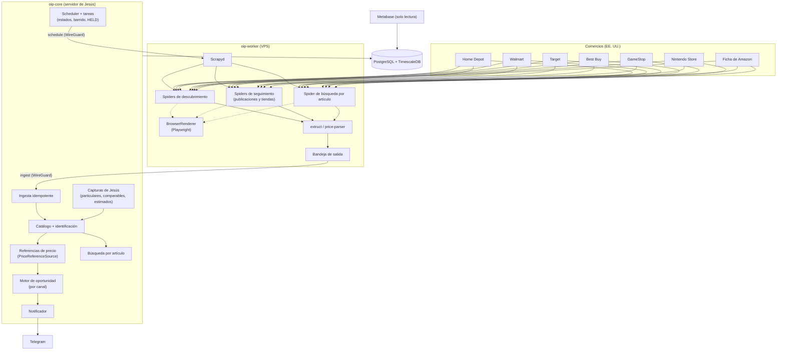
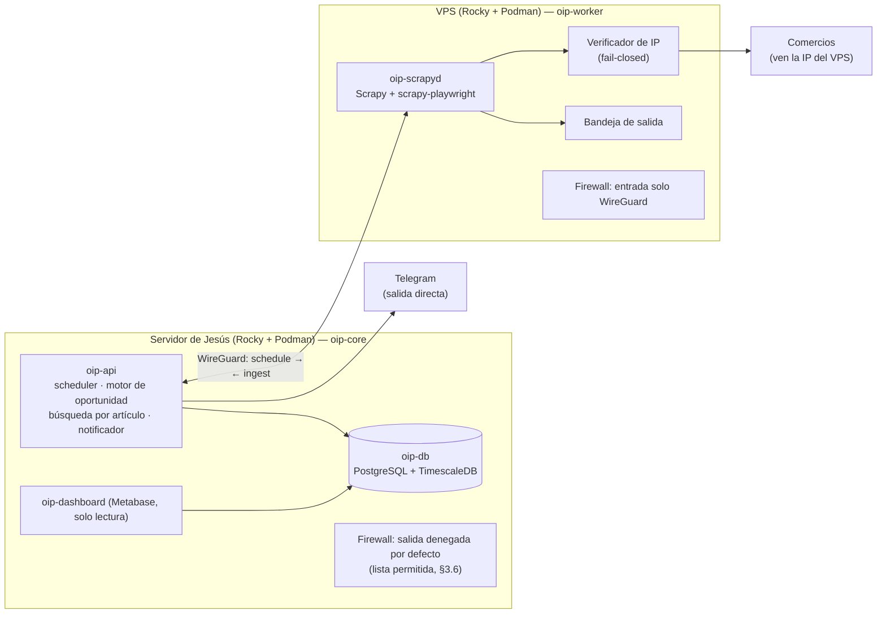
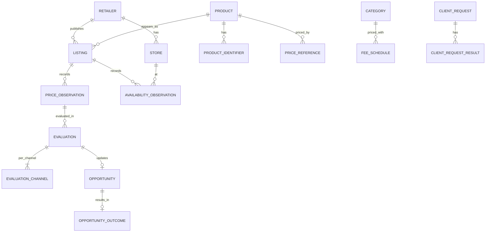

# Offer Intelligence Platform (OIP)

## Arquitectura técnica

**Versión:** 2.2 — texto **consolidado**: cada sección contiene solo lo vigente (DEC-191). La v2.2 alinea la arquitectura con el REQ-2026-0001 v2.7: redondeo de DEC-207 (§2.1), nivel del aviso (§2.7) y capturas de Jesús con el contrato de ingesta 3.1 (§5.4, §8) (DEC-221 a DEC-223). Lo reemplazado ya no aparece aquí y se consulta en las versiones anteriores (tabla "Archivo vigente").
**Fecha:** 17 de noviembre de 2026
**Estado:** Línea base aprobada para construir por incrementos; las decisiones marcadas "PoC" se cierran con datos
**Tipo de producto:** Herramienta interna, uso propio, operación todo el año
**Idioma:** Español

> **Archivo vigente.** La arquitectura vive en un solo archivo. **Nada se borra del historial**: cada versión anterior queda con un enlace permanente a un commit fijo, y §0 conserva el registro de cambios. El texto de las secciones es solo el vigente (DEC-191).
>
> | Versión | Fecha | Dónde |
> |---|---|---|
> | **v2.2** (vigente) | 2026-11-17 | Este archivo (redondeo de DEC-207; nivel del aviso; contrato de ingesta 3.1 con `listed`, `pickupLocation` y capturas por `recordType`) |
> | v2.1 | 2026-11-17 | [enlace permanente](https://github.com/jjrm2004mx/Offer-Intelligence-Platform-OIP/blob/da87f9d08b291db35d25f8be5c760884ca7c7660/docs/arquitectura/arquitectura-tecnica.md) — contrato de ingesta 3.0 con `taxLocation` y códigos cerrados; funcionalidades F1 y F2 |
> | v2.0 | 2026-11-16 | [enlace permanente](https://github.com/jjrm2004mx/Offer-Intelligence-Platform-OIP/blob/f5f10c3631a3d14b33faa6772eff670d03152385/docs/arquitectura/arquitectura-tecnica.md) — consolidación de la v1.4, sin decisiones nuevas |
> | v1.4 | 2026-11-16 | [enlace permanente](https://github.com/jjrm2004mx/Offer-Intelligence-Platform-OIP/blob/640c9f863d7e5177db662835eaa42aad6959202c/docs/arquitectura/arquitectura-tecnica.md) — con las marcas *(v1.2)*, *(v1.3)* y *(v1.4)* y la redacción anterior |
> | v1.3 | 2026-11-09 | [enlace permanente](https://github.com/jjrm2004mx/Offer-Intelligence-Platform-OIP/blob/a00af3f0191d2f78390cd8c4f1c16316214521f9/docs/arquitectura/arquitectura-tecnica.md) |
> | v1.2 | 2026-11-08 | [enlace permanente](https://github.com/jjrm2004mx/Offer-Intelligence-Platform-OIP/blob/a13c81801642f5ac49958fa92a9fd65e425b5948/docs/arquitectura/OIP_Arquitectura_Tecnica_Integrada_v1.2.md) |
> | v1.1 y v1.0 | 2026-11-08 | Fuera del repo: documentos del proyecto en Claude y carpeta OIP del Drive (la v1.0 en `otros/`) |

> **Fuentes:** DEC-001 a DEC-190, DEC-199, DEC-207, DEC-213, DEC-219 a DEC-223 del registro de decisiones y las RN v2. La revisión independiente de los diseños contra estos ADR la hará `oip-arquitecto`, que se crea la primera vez que un REQ toque un ADR (DEC-172).

> **Precedencia.** En reglas de negocio mandan las **RN** (`docs/negocio/reglas/`): esta arquitectura las cita y no copia sus fórmulas completas. En decisiones técnicas manda este documento. Las decisiones están en `docs/proceso/registro-de-decisiones.md` (DEC-xxx).

> **Convención de certeza:** **Verificado** = observado en código o documentación · **Propuesta** = decisión recomendada · **PoC** = no se da por resuelto hasta probarlo.

---

## 0. Registro de cambios

Historial de cambios desde la v1.0. Los ID se conservan; la sección donde quedó cada cambio está en el texto vigente.

| # | Cambio | Motivo |
|---|---|---|
| C-01 | **Oportunidad comercial = margen de reventa**, validado contra precio de mercado, no contra el descuento anunciado. | Definición confirmada. Un 90% de descuento declarado puede ser falso o irrelevante. |
| C-02 | Se agrega todo el **lado de venta**: referencia de mercado (Amazon vía Keepa), match por UPC/GTIN, comisiones, restricciones, demanda. | v1.0 solo diseñaba la compra. |
| C-03 | Se agrega **tienda física** (radio San Diego) con inventario por sucursal y **costo de traslado** en el margen. | Muchas liquidaciones fuertes son solo en tienda. |
| C-04 | Núcleo en **Python (FastAPI)** en lugar de Java/Spring Boot. | Java no es requisito; un solo lenguaje para núcleo y crawling. |
| C-05 | **PriceGhost descartado.** | Sin commits desde 2-feb-2026, 2 autores, sin archivo LICENSE (solo "MIT" en README). |
| C-06 | **PriceStalker sale del núcleo**; queda como candidato opcional detrás de un adaptador, fijado en v2.0.0. | Joven (ene-2026), alta rotación (main en 2.2.0-beta), runtime Node adicional, doble extracción de precio. |
| C-07 | **Capacidad anti-bot (stealth) es requisito**; se elimina "no evadir controles" del fuera de alcance y se registra como riesgo aceptado. | Decisión del dueño del producto. |
| C-08 | **Un solo motor de navegador** (Playwright). | Elimina el segundo runtime (Puppeteer). |
| C-09 | **RabbitMQ y changedetection.io pasan a fase posterior.** Scrapyd + ingesta REST en el arranque. | Volumen inicial no lo justifica. |
| C-10 | Alertas por **Telegram** desde el primer incremento, además del dashboard. | Las ofertas fuertes duran horas. |
| C-11 | Despliegue en **Rocky Linux + Podman rootless con Quadlets** (systemd). | Plataforma objetivo. |
| C-12 | Se agregan OSS de apoyo: **extruct, price-parser, Spidermon, Scrapyd**. | Atacan directamente R-01, R-02, R-03 de v1.0. |
| C-13 | Correcciones editoriales: numeración duplicada en §20, formatos de tabla mixtos, inconsistencia changedetection "si se incorpora" vs ADR-010. | — |
| C-14 | Logística/costos transfronterizos de venta **fuera del modelo**. | Decisión del dueño del producto. |
| C-15 | *(v1.2)* **Rentabilidad ajustada por tiempo**: días de venta, ROI anualizado, riesgo de caída, devoluciones, unidades. | Rentabilidad real, no aparente. |
| C-16 | *(v1.2)* **Confianza del dato de tienda**, antigüedad, re-consulta previa al viaje, registro de visitas. | La disponibilidad no es inventario garantizado. |
| C-17 | *(v1.2)* **Acceso por fuente** con escalera; stealth apagado por defecto (reemplaza C-07). | Decisión por fuente con datos. |
| C-18 | *(v1.2)* **Egress obligatorio** (VPS → proxy), fail-closed; IP doméstica nunca expuesta. | Requisito duro del dueño del producto. |
| C-19 | *(v1.2)* **Puppeteer como motor alternativo por fuente** detrás de una interfaz de renderizado; se construye solo si la PoC-A lo justifica (matiza C-08). | Algunos comercios pueden detectar un motor y no el otro. |
| C-20 | *(v1.3)* **Dos funcionalidades** con un mismo motor de adquisición: **A. búsqueda automatizada** (reventa) y **B. búsqueda particular por artículo** (servicio a clientes; en el Inc. 1 la captura Jesús). | Retroalimentación del experto (DEC-110 a DEC-114). |
| C-21 | *(v1.3)* **Topología Core local + Scraper Worker remoto** (configurable; solo el worker remoto se construye). Precisa §3.4: la consulta nace en el VPS. | DEC-120. |
| C-22 | *(v1.3)* **Consulta responsable**: límites por dominio, pausas, concurrencia 1, caché, reintentos con espera creciente, timeouts y pausa por bloqueo (nueva §3.5). | DEC-115, RN-010. |
| C-23 | *(v1.3)* **Modo de red de la PoC** (`modo_red: estricto \| desarrollo`) con lista permitida y bloqueo de comercios desde casa por firewall (nueva §3.6). | DEC-121. |
| C-24 | *(v1.3)* **Infraestructura de referencia** del VPS y costos (por verificar); Rocky + Podman también en el VPS. | DEC-118, DEC-119. |
| C-25 | *(v1.3)* **Alineación con las RN** (prevalecen en reglas de negocio): rendimiento mensual en vez de ROI anualizado, niveles por mínimos, precio de venta conservador sin ajuste por competencia, `MARKET_ALREADY_CHEAP` sin condición del 50%, viaje fuera del margen por unidad. | DEC-028; RN-001 a RN-009. |
| C-26 | *(v1.3)* Sugerencias técnicas del experto **no adoptadas**: Java/Spring Boot y Ubuntu + Docker. | DEC-118. |
| C-27 | *(v1.4)* **Referencia de precio por etapas:** historial propio + comparación entre comercios → APIs oficiales → Keepa al final. **Keepa diferido**: no entra en el Inc. 1; cuando entre, solo para Amazon, complementario y contratado por meses. Cada fuente detrás de una interfaz intercambiable, guardando cuál se usó. | DEC-123, DEC-124, DEC-125. |
| C-28 | *(v1.4)* **Tres indicadores** (descuento, competitividad, demanda) y **cuatro referencias** (precio habitual, precio de mercado hoy, MSRP, precio tachado); el descuento real solo contra el precio habitual, con **historial suficiente** (mediana de 60 días, ≥ 5 observaciones en ≥ 3 días). | DEC-128, DEC-129, DEC-130, DEC-147; RN-002 v2. |
| C-29 | *(v1.4)* **Dos ejes de clasificación:** calidad del precio (RN-012) y oportunidad de reventa (RN-009); la búsqueda por artículo usa solo el primero. Niveles renombrados: Comprar ya · Muy recomendable · Recomendable · Vigilar. | DEC-131, DEC-164. |
| C-30 | *(v1.4)* **Comercios del Inc. 1:** Home Depot, Walmart, Target, Best Buy, GameStop, Nintendo Store y la ficha de Amazon; solo EE. UU., USD. | DEC-132. |
| C-31 | *(v1.4)* **APIs oficiales** como escalón `api_feed`; comparadores y sitios de seguimiento **solo como señal**, confirmando cada precio en la ficha del comercio. | DEC-133, DEC-154. |
| C-32 | *(v1.4)* **Datos de cada observación** ampliados (vendedor, estado del producto, estados de disponibilidad en línea, envío, MSRP con fuente y fecha, contenido) y **contrato de ingesta 2.0** (§8). | DEC-134, DEC-169; RN-013. |
| C-33 | *(v1.4)* **Evaluación por canal** (Amazon FBM y venta local) con elección del mejor canal; **3 orígenes × 2 canales**; origen y canal independientes. | DEC-140, DEC-146, DEC-151, DEC-170; RN-016 a RN-018. |
| C-34 | *(v1.4)* **Usados y particulares por captura manual**, con estado obligatorio y valor de usados comparables. | DEC-149, DEC-150; RN-014, RN-015. |
| C-35 | *(v1.4)* **Costos por etapa y VPS creciente** (2 vCPU / 4 GB para arrancar; 4 / 8 al medir > 75% de memoria). | DEC-126, DEC-127. |
| C-36 | *(v1.4)* **Dos repositorios, Core y Worker**; el Core no contiene spiders y un gate lo verifica. | DEC-173; precisa ADR-022. |
| C-37 | *(v1.4)* **Contratos Core ↔ Worker versionados** (N y N-1) y **bandeja de salida** en el Worker. | DEC-174, DEC-175. |
| C-38 | *(v1.4)* **Estados de tareas** con transiciones condicionales, **barrido de recuperación** y estado `HELD`. | DEC-176. |
| C-39 | *(v1.4)* **IA opcional:** el código decide y la IA complementa, con interruptor de tres modos (nueva §5.5). | DEC-177. |
| C-40 | *(v1.4)* **Operación endurecida:** puertos en `127.0.0.1`, migraciones versionadas, Metabase con rol de solo lectura, logs sin contenido, runbook con trampas conocidas. | DEC-178 a DEC-183. |
| C-41 | *(v1.4)* **Guía de estilo** y formato de los avisos de Telegram; los emoji ⚡ ✅ 👍 🛑 🧪 reemplazan 🔴🟠🟡⚪. | DEC-184 a DEC-190. |
| C-42 | *(v1.4)* **Alineación con las RN v2:** franjas del descuento real (20% / 25%), umbrales de niveles y mínimo por unidad, mínimo de 60 días (no 90), pago de Amazon a 30 días (no 14), demanda por percentil de la categoría, zonas desde la garita, confianza en tienda, consulta responsable escalonada. | DEC-155 a DEC-171; RN v2. |
| C-43 | *(v2.0)* **Consolidación:** las secciones quedan solo con el texto vigente; el historial se conserva en los enlaces permanentes y en esta tabla. Sin decisiones nuevas respecto a la v1.4. | DEC-191. |
| C-44 | *(v2.1)* **Contrato de ingesta 3.0** (§8): manda sobre el REQ, que solo lo cita; agrega `taxLocation` y la **tabla cerrada de códigos** de `availability.state`, `category` y `condition` (inglés, snake_case; español solo en avisos y Metabase); dice qué campos son obligatorios. Las funcionalidades pasan a llamarse **F1** (reventa) y **F2** (servicio a clientes); "parte A a D" queda para el REQ (§1, §3.1, §5.4). | DEC-199, DEC-213, DEC-220; EXT-005, EXT-019. |
| C-45 | *(v2.2)* **Alineación con el REQ-2026-0001 v2.7** (reinspección v8): el redondeo sigue la lista cerrada de DEC-207, una vez por fórmula (§2.1); el aviso usa el nivel más alto entre los canales (§2.7, S-33 del REQ); **contrato de ingesta 3.1** (§8): código `listed` en `availability.state` y campo opcional `pickupLocation` para la publicación de un particular; las demás capturas de Jesús tienen su propio esquema, con `recordType` (§5.4). | DEC-221, DEC-222, DEC-223; D-039, D-040, D-041 de la inspección v8. |

---

## 1. Resumen ejecutivo

OIP es una herramienta interna que **detecta productos que se pueden comprar muy por debajo de su precio real de mercado y revender con margen**, y que **ayuda a Jesús a conseguir para sus clientes el artículo que piden donde esté más económico y disponible**. Funciona todo el año, con picos de temporada (Black Friday, Navidad, regreso a clases, liquidaciones de fin de temporada).

El flujo central:

> **Descubrir ofertas** (en línea, tienda física y particulares por captura manual) → **identificar el producto** (código de barras o modelo + marca, RN-013) → **referencias de precio** del historial propio y de la comparación entre comercios (RN-002) → **descuento real y calidad del precio** (RN-003, RN-012) → **margen por canal** (Amazon FBM y venta local) → **elegir canal** (RN-018) → **nivel o revisión manual** (RN-009) → **avisar** por Telegram y mostrar en el tablero.

Dos funcionalidades comparten el mismo motor de adquisición (API · HTTP · navegador) y los mismos controles de consulta responsable (RN-010):

| | Funcionalidad | Disparo | Resultado | Reglas |
|---|---|---|---|---|
| **F1** | Búsqueda automatizada de ofertas (reventa) | Periódica (scheduler) | Oportunidades con canal, nivel y avisos | RN-001 a RN-009, RN-012 a RN-018 |
| **F2** | Búsqueda particular por artículo (servicio a clientes) | Bajo demanda: Jesús captura la solicitud del cliente | Alternativas ordenadas: la más económica entre las disponibles | RN-011 |

Los nombres **F1** y **F2** son de la arquitectura; las **partes A a D** son del REQ-2026-0001 (F1 = partes A a C; F2 = parte D) (DEC-213).

**Topología:** **OIP Core** en el servidor de Jesús y **Scraper Worker** en un VPS, en **dos repositorios** (§3.4.1). La casa nunca consulta comercios.

**Stack del Inc. 1:** Python (FastAPI + Scrapy + scrapy-playwright), PostgreSQL + TimescaleDB, Telegram y Metabase, desplegado con Podman rootless y Quadlets en Rocky Linux, en el Core y en el VPS. **Keepa está diferido** (§4.3).

---

## 2. Definición de oportunidad comercial

### 2.1 Indicadores y margen

**Tres indicadores que no se mezclan** (DEC-128):

| Indicador | Contra qué | Regla |
|---|---|---|
| **Descuento** | Precio habitual (historial) | RN-003 |
| **Competitividad** | Precio de mercado hoy (otros comercios) | RN-012 |
| **Demanda** | Ranking y vendedores en Amazon; demanda local | RN-004, RN-017 |

El **descuento anunciado** (`1 − oferta ÷ precio tachado`) solo sirve para **descubrir** candidatos; no decide nada.

**Margen, por canal** (RN-001):

```
costo de compra        = precio + impuesto de venta + envío hacia mí
                         (+ recogida, en compras a particulares, RN-008)
costo de venta (canal) = Amazon FBM:  comisión + envío al cliente + empaque + otros   (RN-006)
                         Venta local: costo de entrega (RN-008) + otros
margen neto ($)        = precio de venta esperado (canal) − costo de compra − costo de venta (canal)
margen neto (%)        = margen neto ($) ÷ costo de compra × 100
```

- Margen % **sobre lo invertido**.
- Las compras en línea van a un **PO Box en San Diego** (impuesto de esa zona; dirección pendiente). La cuota mensual de Amazon es un gasto fijo, fuera del margen por unidad (DEC-156).
- El costo del **viaje a tienda** no entra en el margen por unidad: se evalúa por viaje completo (§6.3, RN-008).
- **Redondeo** (DEC-060, precisada por DEC-207 y DEC-222): montos con `Decimal`. Solo se redondean a centavos, con el medio centavo hacia arriba, los montos de la **lista cerrada** del REQ-2026-0001 §5 (impuesto, costo de compra, comisión, envío, devoluciones, castigo, precio de venta local, valor de referencia de usados, traslados, margen neto, margen ajustado y ganancia total), y cada fórmula de varios factores se redondea **una sola vez, al final** (venta local = mercado hoy × 85% × 90%). Porcentajes sin redondear para calcular y comparar, mostrados con 1 decimal.

### 2.2 Referencias de precio

**Cuatro referencias separadas** (RN-002, DEC-129, DEC-147):

| Referencia | Cómo se obtiene | Para qué |
|---|---|---|
| **Precio habitual** | Mediana de 60 días del historial propio, con **historial suficiente**: ≥ 5 observaciones en ≥ 3 días distintos (DEC-130) | Descuento real |
| **Precio de mercado hoy** | El más bajo de hoy (dato ≤ 48 h), disponible, en los comercios seguidos, sin la oferta evaluada | Competitividad y calidad del precio |
| **MSRP** | Precio del fabricante, con fuente y fecha | Solo sin historial; la calidad no pasa de "Precio competitivo" |
| **Precio tachado** | El "antes" del comercio | **Nunca es referencia**; solo detecta descuentos inflados |

- **Precio de venta en Amazon** = botón de compra hoy. Sin oferta nueva hoy: precio habitual en Amazon, marcado `SIN OFERTA HOY` (DEC-157).
- **Mínimo de 60 días en Amazon:** lo usa el castigo por baja (§2.5.1).
- **Competencia más barata:** precio de mercado hoy < venta en Amazon × 85% → el canal Amazon baja un nivel.

**Fuentes, por etapas** (DEC-123): (1) **historial propio** de OIP reforzado con la comparación entre comercios (sin historial, solo la comparación); (2) **APIs oficiales** de los comercios cuando el producto madure; (3) **Keepa al final** (§4.3). Cada fuente se conecta por una interfaz intercambiable (`PriceReferenceSource`) y cada referencia guarda la fuente usada. Comparadores y sitios de seguimiento son **solo señal**: cada precio se confirma en la ficha del comercio (DEC-154).

### 2.3 Descuento real y descuentos falsos

```
descuento real (%) = (1 − precio de oferta ÷ precio habitual) × 100
```

- Franjas y marcas según RN-003 v2 (DEC-158).
- **Filtro previo** (descubrimiento): se investigan las ofertas con descuento anunciado ≥ 40%, marca reconocida y categoría acordada. Es necesario por los límites de consulta (RN-010) y no califica la oferta.

| Descuento real | Marca | Efecto |
|---|---|---|
| < 20% | `MERCADO YA BARATO` | Descartada (caso de la lámpara) |
| 20% a < 25% | `SOLO REFERENCIA` | Solo tablero |
| ≥ 25% | — | Sigue en evaluación |

| Marca | Cuándo | Efecto |
|---|---|---|
| `PRECIO ANTES INFLADO` | Tachado > 1.5 × mediana de 60 días de esa tienda (con historial suficiente) | Se ignora el descuento anunciado |
| `SIN HISTORIAL SUFICIENTE` | No hay precio habitual | Revisión manual, sin aviso |
| `DESCUENTO ANUNCIADO NO COMPROBADO` | Hay tachado, pero no hay historial de esa tienda | Aviso en el tablero |
| `COINCIDENCIA NO CONFIRMADA` | Identificado solo por nombre (RN-013) | Revisión manual, sin aviso |

**Ejemplo (lámpara):** Walmart anuncia antes $200, ahora $20 (90% anunciado). El precio habitual es $22. Descuento real 9.1% → `MERCADO YA BARATO`, descartada.

### 2.4 Niveles y precedencia

**Niveles por canal** (RN-009, DEC-164): se asigna el más alto cuyas dos condiciones se cumplan.

| Nivel | Descuento real | Margen ajustado % | Aviso |
|---|---|---|---|
| ⚡ **Comprar ya** | ≥ 80% | ≥ 50% | Inmediato |
| ✅ **Muy recomendable** | ≥ 70% | ≥ 40% | Inmediato |
| 👍 **Recomendable** | ≥ 50% | ≥ 30% | Resumen a las 8:00 y 18:00 (Tijuana) |
| **Vigilar** | ≥ 25% | ≥ 25% | Solo tablero |

- **Mínimo por unidad:** margen ajustado ≥ el mayor entre $10 y 10% del costo de compra.
- **Tienda física:** confianza Alta o Media (§6.3.1).
- **Precedencia:** DESCARTADA > SOLO REFERENCIA > REVISIÓN MANUAL > nivel. La revisión manual guarda su `nivel_calculado`.
- **Avisos:** un aviso por cadena, con las sucursales ordenadas por cercanía a la garita; no se repite en 24 h salvo que suba de nivel o el precio baje ≥ 5%. Formato y emoji: guía de estilo §10 (DEC-189). El rojo se reserva para problemas operativos (🛑) y el modo desarrollo se marca 🧪.
- **Dos ejes visibles a la vez** (DEC-131, DEC-186): nivel de oportunidad (RN-009) y **calidad del precio** (RN-012: Oferta excepcional · Buena oferta · Precio competitivo · Descuento cuestionable · Precio normal). La búsqueda por artículo usa solo la calidad del precio.

Todos los valores son iniciales y configurables (DEC-155).

### 2.5 Demanda

- **Amazon SUFICIENTE** (RN-004, DEC-159): ranking en la categoría principal ≤ **0.5% del total de artículos** de la categoría (relojes y joyería: además primeros 100 de la subcategoría) **y** ≤ 20 vendedores de nuevo. Se usan promedios de 7 días.
- `DEMANDA A LA BAJA`: el promedio de 7 días empeora > 50% contra el de hace 30 días (advertencia).
- Sin ranking, sin vendedores o sin tamaño de categoría: `DEMANDA DESCONOCIDA` → canal Amazon "por revisar".
- Demanda insuficiente **cierra el canal Amazon, no la oferta**: se evalúa la venta local.
- **Demanda local** (RN-017): alta 7 días por unidad, media 14 (valor inicial), baja → canal local no viable. Con 5 ventas reales se recalibra.
- Sin Keepa, el ranking, los vendedores y "N+ comprados el mes pasado" salen de la **ficha de Amazon** que consulta el Worker.

### 2.5.1 Rentabilidad ajustada por tiempo

Un margen alto que tarda meses en venderse puede valer menos que uno moderado que se vende en días (RN-005, DEC-160):

```
costo por devoluciones = venta × tasa de devolución × pérdida por devolución       (Amazon; local 0%)
castigo por baja       = 50% × (venta − mínimo de 60 días en Amazon)               (sin mínimo: 10% de la venta)
margen ajustado        = margen neto − costo por devoluciones − castigo por baja
días para recuperar    = días de venta + días de pago
rendimiento mensual    = margen ajustado % × 30 ÷ días para recuperar
```

- **Días de venta:** Amazon por ranking (< 10,000 → 7; 10,000 a 50,000 → 21; más → 45); local según RN-017.
- **Días de pago:** Amazon **30** con cuenta nueva, 21 con historial; local 0.
- **Unidades recomendadas:** el menor entre las ventas al mes que le tocan a Jesús, las disponibles, el límite por cliente y el **tope de primera compra** (3; 5 en casos muy buenos), que se levanta con resultados reales.
- Menos de 1 venta al mes para Jesús → canal cerrado, `SIN ROTACIÓN`.
- Dentro de cada nivel, las oportunidades se **ordenan por rendimiento mensual**.

### 2.6 Restricciones de venta

- Tres niveles: **categoría, marca y producto** (RN-006, DEC-161). Material peligroso, usados en categorías sensibles y juguetes en temporada. Los productos con caducidad quedan fuera del alcance.
- **Restringido en Amazon → se evalúa la venta local.**
- Lista de productos que se **evitan siempre** → DESCARTADA. Riesgo de procedencia o vendedor externo → revisión manual (RN-015, DEC-137).
- Envío FBM y empaque por tabla de peso; más de 6 kg, con cotización capturada.
- Sin cuenta de vendedor: tabla manual configurable, marcada "estimado". Con cuenta: adaptador SP-API (preparado, desactivado).

### 2.7 Canales de venta y elección del mejor canal

Cada oportunidad se evalúa **por canal** y se elige uno (RN-018, DEC-140, DEC-151, DEC-170). El origen de compra y el canal de venta son **independientes** (DEC-146).

| | Orígenes de compra (Inc. 1) | Canales de venta (Inc. 1) |
|---|---|---|
| 1 | Tienda en línea (envío al PO Box o recoger en tienda) | **Amazon FBM**: comisión, envío y restricciones estimados con tabla manual |
| 2 | Tienda física | **Venta local** (OfferUp, Facebook Marketplace y venta personal): precio de RN-016 (estimado de Jesús o 85% del mercado hoy, con techo de comparables y 10% de negociación) |
| 3 | Particulares, por captura manual (DEC-150) | — |

- **Estado de cada canal:** cerrado, por revisar o disponible (REQ-2026-0001 §3.2.1). Un canal cerrado no cierra la oferta.
- **Elección:** mayor ganancia total del lote (margen ajustado × unidades); si la diferencia contra la mayor es < 10%, desempata el rendimiento mensual.
- El tablero muestra **los dos canales** con sus números. El aviso usa el **nivel más alto entre los canales con nivel**, aunque el canal elegido sea otro, y muestra aparte el canal con mejor ganancia y el de mejor nivel (DEC-219, DEC-221; REQ-2026-0001 S-33, que prevalece sobre RN-018 §4 y RN-009 §3 hasta el cambio en bloque de las RN).
- **Compra por oportunidad** (DEC-141): se puede comprar por precio excepcional y conservar el producto hasta encontrar comprador; el riesgo se mide con los días para vender y el rendimiento mensual.

---

## 3. Alcance

### 3.1 Dentro del alcance

| Dimensión | Alcance |
|---|---|
| Operación | Todo el año, con perfiles de temporada (frecuencia mayor en temporadas altas) |
| Funcionalidades | **F1.** Búsqueda automatizada de ofertas. **F2.** Búsqueda particular por artículo: en el Inc. 1 el cliente pide a Jesús y Jesús captura en OIP; la solicitud directa del cliente (p. ej. WhatsApp) es futura |
| Comercios (Inc. 1) | **Home Depot, Walmart, Target, Best Buy, GameStop, Nintendo Store** y la ficha de Amazon, para las dos funcionalidades; solo tiendas de EE. UU. y USD (DEC-132). Cada comercio es un conector configurable |
| Categorías | Las que más consume la gente, priorizadas por temporada (DEC-138, DEC-153): herramientas (prioridad), hogar y cocina, tecnología, juguetes y videojuegos, relojes, joyería, perfumes |
| Orígenes de compra | En línea, tienda física (radio por zonas desde la garita, §6.3) y particulares por captura manual |
| Canales de venta | Amazon FBM y venta local (§2.7) |
| Estado del producto | Nuevo, caja abierta, reacondicionado, usado, para piezas; los no nuevos solo se evalúan en venta local (DEC-149, RN-014) |
| Notificación | Telegram + tablero (Metabase en el Inc. 1) |
| Seguimiento | Precio, disponibilidad (en línea y por tienda) e historial propio |
| Administración | Comercios, tiendas, categorías, frecuencias, umbrales y tablas de comisiones, envíos y restricciones, todo configurable y versionado |

### 3.2 Fuera del alcance (por ahora)

- Compra automática, carrito o checkout.
- Publicación automática en Amazon o Facebook (el adaptador de Amazon queda preparado).
- Resolver CAPTCHA con servicios de terceros (se registra el bloqueo y se reintenta más tarde).
- Sesiones con cuentas personales de las tiendas.
- Keepa en el Inc. 1 (§4.3) y la cuenta de vendedor de Amazon / SP-API.
- Búsqueda automática en sitios de particulares y Facebook Marketplace con datos observados (DEC-140, DEC-150).
- Logística y costos transfronterizos de la venta (§6.4).

### 3.3 Acceso a comercios: decisión por fuente

Cada fuente tiene un `access_mode` y sube la escalera solo con datos. La capacidad stealth existe en la capa de navegador, pero **está apagada por defecto** en todas las fuentes.

| Escalón | `access_mode` | Cuándo |
|---|---|---|
| 0 | `api_feed` | Existe API oficial, feed o sitemap utilizable (Amazon, Walmart u otros, cuando se autoricen, DEC-133) |
| 1 | `http` | La página entrega los datos sin JavaScript |
| 2 | `browser` | Requiere renderizado; navegador normal |
| 3 | `browser_stealth` | Solo si la tasa de bloqueo medida inutiliza la fuente **y** no hay alternativa en los escalones 0–2 |

- Subir a `browser_stealth` es un **cambio manual de configuración** de Jesús (gate **G5**), registrado con fecha y motivo; el sistema mide la tasa de bloqueo antes y después.
- Si el bloqueo supera el umbral incluso en el escalón 3, la fuente **se pausa sola** y avisa por Telegram.
- Métrica de **tasa de bloqueo por fuente y escalón** desde el primer día.
- Riesgo aceptado para fuentes en escalón 3: posible incumplimiento de términos de uso (R-09).

#### 3.3.1 Motor de navegador por fuente

Los spiders no invocan un navegador concreto: piden el renderizado a una interfaz `BrowserRenderer`, y el motor se elige por fuente con `browser_engine`:

- **`playwright`** (por defecto), integrado en los workers Scrapy con scrapy-playwright.
- **`puppeteer`** (alternativa): servicio Node.js aparte (`oip-renderer-puppeteer`) que recibe la URL y devuelve el HTML. Se construye **solo** si la PoC-A encuentra una fuente que pasa con Puppeteer y no con Playwright. Su tráfico sale por el mismo camino que el del Worker.

### 3.4 Protección de la IP doméstica (requisito duro)

**La IP de la casa nunca consulta comercios** (DEC-041). Se garantiza por topología, no solo por configuración:

- Toda consulta a comercios **nace en el VPS** (§3.4.1); la casa no tiene ruta de scraping.
- **Fail-closed:** si el Worker no está o su verificación falla, no hay consultas. Nunca hay respaldo desde la casa.
- **Verificación al arrancar cada trabajo:** el Worker consulta su IP pública y aborta si no es la IP autorizada del VPS.
- El navegador bloquea imágenes, fuentes y media para reducir consumo.
- El tráfico a APIs legítimas (Telegram; Keepa y SP-API cuando existan) sale directo desde `oip-api`.
- **Etapas:** primero el VPS (IPs de datacenter, más propensas a bloqueo; se mide); con volumen, proxies residenciales de pago por GB por fuente (DEC-117).
- **Modo túnel** (Worker en casa detrás de `oip-egress` por WireGuard o proxy): queda **documentado y sin construir**. La interfaz del Core lo permite (§3.4.1), pero solo se construye y opera el Worker remoto.

#### 3.4.1 Topología Core + Scraper Worker, en dos repositorios

| Pieza | Dónde | Repositorio | Contiene |
|---|---|---|---|
| **OIP Core** | Servidor de Jesús (Rocky + Podman) | `oip-core` (este repo) | `oip-api` (FastAPI: scheduler, ingesta, catálogo, identificación, referencias de precio, motor de oportunidad, búsqueda por artículo, notificador), `oip-db`, `oip-dashboard`, `oip-backup`; documentación de negocio y proceso, REQ, inspecciones y agentes |
| **OIP Scraper Worker** | VPS (Rocky + Podman) | `oip-worker` | `oip-scrapyd` (Scrapy + scrapy-playwright + Chromium, `BrowserRenderer`), verificador de IP, firewall de salida, **bandeja de salida**; su propio `CLAUDE.md`, `openspec/` y runbooks del VPS |
| **Canal** | WireGuard Core ↔ Worker | Contratos en los dos repos | Core → Worker: `schedule` (trabajos). Worker → Core: `ingest` (resultados). Ningún puerto expuesto a Internet salvo WireGuard en el VPS |

Reglas:

- **El repo del Core no contiene spiders ni clientes HTTP hacia comercios**, y un gate lo verifica (DEC-173). Los repos se separan en la Etapa 3, antes de la primera línea del Worker.
- El firewall del VPS permite salida HTTPS a los comercios y entrada **solo** por WireGuard; Scrapyd solo escucha en la interfaz WireGuard.
- Autenticación del canal: claves WireGuard + **token por servicio** en `schedule` e `ingest` (`podman secret`).
- Contratos versionados en los dos repos (§8). En el Worker, los commits citan el REQ como `jjrm2004mx/<core>#N` (DEC-174).
- **Configurable:** el Core usa una sola interfaz (`ACQUISITION_WORKER_URL` + endpoint de ingesta), así que el Worker puede crecer a varios hosts o ir detrás de proxies sin tocar el Core.

### 3.5 Consulta responsable (RN-010)

| Control | Implementación | Valor inicial |
|---|---|---|
| Límite de consultas | `CONCURRENT_REQUESTS_PER_DOMAIN=1` + `DOWNLOAD_DELAY` y limitador por dominio en el Worker | ≤ 6 por minuto por comercio |
| Pausa entre consultas | `DOWNLOAD_DELAY=10` con aleatorización al rango 10–15 s; AutoThrottle como techo | 10–15 s |
| Concurrencia | 1 por comercio; comercios distintos en paralelo | 1 / comercio |
| Caché | En el Core, por publicación: 6 h (búsqueda automatizada), **1 h** (búsqueda por artículo) | 6 h / 1 h |
| Reintentos | Cola de reintentos del Core; no se usa el reintento inmediato de Scrapy para bloqueos | 1, 5 y 15 min |
| Timeout | `DOWNLOAD_TIMEOUT` (HTTP) y timeout de navegación (Playwright) | 30 s / 60 s |
| Pausa por bloqueo | Con ≥ 10 consultas en la hora y > 20% bloqueadas, **escalonada**: 24 h → 48 h (dentro de 7 días desde la reanudación) → hasta que Jesús autorice; cada pausa avisa (🛑) | 20% / 24 h / 48 h |
| robots.txt | `ROBOTSTXT_OBEY` **activado por defecto**; excepción solo por comercio y registrada (DEC-165) | Se respeta |
| Términos de uso | Revisados comercio por comercio antes de activarlo | — |
| Prioridad | La **solicitud de un cliente** pasa antes que la búsqueda automatizada, con los mismos límites | — |
| Antes de salir | Siempre se re-consulta la disponibilidad, sin caché | — |

Postura (DEC-116): OIP no pretende ocultarse ni evadir restricciones.

### 3.6 Modo de red para la prueba de concepto (DEC-121, DEC-122)

- `modo_red: estricto | desarrollo`, **estricto por defecto**.
- **Estricto:** toda consulta a comercios va al Worker en el VPS; el Core no tiene ruta de scraping.
- **Desarrollo:** permite ejecutar en casa **solo** contra una lista permitida (datos guardados, simulaciones, APIs que permiten automatización). Activarlo deja registro (quién y cuándo) y un aviso visible (🧪).
- **Límite duro, independiente de la aplicación:** el firewall del servidor de Jesús (firewalld / nftables) **deniega por defecto** la salida de los contenedores y solo permite destinos aprobados (Telegram, el endpoint WireGuard del VPS, el registro de imágenes, los servicios de prueba del modo desarrollo; Keepa cuando exista), en un `set` de nftables con resolución DNS controlada. Cualquier otro destino —**incluidos todos los comercios, presentes y futuros**— queda bloqueado sin conocer sus IPs. Cada conexión rechazada se registra y un intento hacia un comercio genera un aviso. Ninguna opción de OIP modifica estas reglas.

---

## 4. Auditoría Open Source

### 4.1 Tabla de decisión

| Proyecto | Licencia | Rol en OIP | Decisión |
|---|---|---|---|
| **Scrapy** | BSD-3-Clause | Descubrimiento y seguimiento | **Adoptar** (núcleo del Worker) |
| **scrapy-playwright** | BSD-3-Clause | Renderizado de páginas dinámicas | **Adoptar** selectivo |
| **Scrapyd** | BSD-3-Clause (verificar) | Ejecutar spiders por API HTTP | **Adoptar** |
| **extruct** | BSD (verificar) | Leer JSON-LD / microdata (GTIN, precio, disponibilidad) | **Adoptar** |
| **price-parser** | BSD (verificar) | Parsear precios en texto | **Adoptar** |
| **Spidermon** | BSD (verificar) | Monitoreo de calidad de extracción | Incremento 2 |
| **PriceStalker** | MIT | Seguimiento alternativo | **Opcional**, PoC-D |
| **PriceGhost** | Sin LICENSE (solo README) | — | **Descartado** |
| **changedetection.io** | Apache-2.0 | Disparador de descubrimiento por cambio | Incremento 3 |
| **TimescaleDB** | Apache-2.0 (core) / TSL (algunas funciones) | Series de tiempo de precios | **Adoptar** |
| **Keepa API** | Comercial | Historial y Sales Rank de Amazon, complementario | **Diferido** (§4.3) |
| **Amazon SP-API** | Comercial (requiere cuenta de vendedor) | Comisiones exactas, restricciones | Adaptador preparado, desactivado |

### 4.2 PriceStalker — hallazgos verificados en código (8-nov-2026)

- Repo creado en enero de 2026; 477 commits, **176 en los últimos 90 días**; ~3 mantenedores efectivos.
- Única estable: **v2.0.0 (31-ago-2026)**; `main` en v2.2.0-beta.2, y `version.json` inconsistente con los tags.
- Usa `puppeteer-extra-plugin-stealth`. Tiene webhooks de alertas (6 eventos), no de cada observación: el historial completo requiere polling.
- Despliegue con Docker Compose; en Podman, con `podman-compose` o `podman kube play` (PoC).

**Por qué no está en el núcleo:** OIP ya sigue precios con Scrapy para su historial propio. Con PriceStalker el precio se extraería dos veces, el historial quedaría en dos bases y se agrega Node + Puppeteer. Queda como **benchmark** (PoC-D): si extrae notablemente mejor en algún comercio, entra para ese comercio detrás de un adaptador `TrackingProvider`.

### 4.3 Keepa: diferido

**No entra en la PoC ni en el Inc. 1** (DEC-124). Las referencias salen del historial propio y de la comparación entre comercios (§2.2).

- **Cuando entre:** solo para productos de Amazon, como fuente **complementaria** de historial de precio y Sales Rank; contratada **por meses** ante una necesidad concreta (por ejemplo, un producto que pide un cliente y que OIP nunca siguió). Sus resultados se guardan y se reutilizan. Su historial es de Amazon, no del mercado completo.
- La integración puede desarrollarse antes con **respuestas simuladas**, detrás de `PriceReferenceSource`.
- Referencia (terceros, por confirmar): plan de entrada ~49 €/mes, 20 tokens/min; los tokens expiran a los 60 min.
- **Filosofía de contratación** (DEC-125): gratis o local primero; pago por consumo cuando sea posible; suscripción solo con valor comprobado.

---

## 5. Arquitectura lógica



### 5.1 Responsabilidades

| Componente | Hace | No hace |
|---|---|---|
| Spiders de descubrimiento | Recorrer ofertas, liquidaciones y categorías acordadas; aplicar el filtro previo; emitir candidatos con evidencia | Decidir identidad ni oportunidad |
| Spiders de seguimiento | Re-consultar precio y disponibilidad de publicaciones seleccionadas, por tienda cuando aplica, para formar el historial propio | Descubrir |
| Spider de búsqueda por artículo | Buscar los modelos de una solicitud de cliente en los comercios del Inc. 1, con prioridad | Ordenar ni recomendar |
| Bandeja de salida | Guardar cada resultado y entregarlo al Core con reintentos | Evaluar |
| Scrapyd | Ejecutar trabajos de spiders por API | Planificar (lo hace el Core) |
| Ingesta | Validar esquema y dominio autorizado, canonicalizar URL, deduplicar | Consultar comercios |
| Catálogo e identificación | Ligar publicaciones a un producto por código de barras o modelo + marca (RN-013) | Fusionar sin evidencia |
| Referencias de precio | Calcular precio habitual, mercado hoy, MSRP y mínimo de 60 días, guardando la fuente | — |
| Motor de oportunidad | Aplicar §2 completo por canal, elegir canal y asignar resultado y nivel | Comprar o publicar |
| Búsqueda por artículo | Ordenar las alternativas según RN-011 | Comprar |
| Notificador | Telegram con deduplicación, agrupación y reintentos | — |

### 5.2 Ejecución asíncrona

- **Scrapyd** para los spiders (Worker) y **cola de tareas sobre PostgreSQL** (p. ej. Procrastinate) en el Core. Sin broker adicional; RabbitMQ solo si hay más de un nodo o la cola en Postgres se vuelve cuello de botella (ADR-010).
- **Estados de tareas** con transiciones condicionales (`UPDATE … WHERE estado = <anterior>`): dos procesos nunca toman el mismo paso (DEC-176).
- **Barrido de recuperación** periódico: re-encola lo atascado o lo que ya debe reintentarse (`next_attempt_at`).
- Estado **`HELD`** para lo que necesita a Jesús (por ejemplo, una fuente en pausa que pide autorización).
- La base es la fuente de verdad; la cola solo avisa. Nada depende de que un proceso siga vivo.

### 5.3 Despliegue físico



### 5.4 Flujos de las dos funcionalidades

**F1. Búsqueda automatizada:** scheduler del Core → `schedule` (descubrimiento o seguimiento) → el Worker consulta los comercios con los controles de §3.5 → bandeja de salida → `ingest` → catálogo e identificación → referencias de precio → motor de oportunidad **por canal** (RN-001 a RN-009, RN-012 a RN-018) → elección de canal → resultado y nivel → avisos y tablero.

**F2. Búsqueda por artículo:** Jesús captura la solicitud (`client_request`: alias del cliente, 1 a 3 modelos, cantidad, estados aceptados, modalidad) → el Core usa la caché de **1 hora o menos** → para lo que falte, `schedule` con prioridad sobre los trabajos periódicos y los mismos límites → `ingest` → ordenamiento de RN-011 (disponibles por precio total; el resto aparte, con su motivo) → resultado consultable y exportable. Tiendas físicas: Zonas 1 y 2, máximo 5 por comercio. En la modalidad "Jesús compra y entrega", el viaje y la entrega se muestran aparte y **no cambian el orden** (DEC-166, DEC-168). Las opciones de **vendedor externo** se marcan y no se recomiendan por defecto; los canales especiales (Walmart Business) se marcan "puede requerir cuenta especial" (DEC-135). Las **sugerencias** de ofertas relacionadas (DEC-139) se agregan cuando RN-011 defina su criterio.

**Amazon** se consulta como un comercio más: la **ficha de Amazon** (botón de compra, vendedores de nuevo, ranking, reseñas y "comprados el mes pasado") la lee el Worker.

**Capturas manuales** de Jesús (DEC-223): entran por el Core con un solo cargador (archivo en el Inc. 1). La **publicación de un particular** es una observación del contrato de ingesta 3.1 (§8: `seller` y `purchaseMode` `particular`, `availability.state: listed`, `pickupLocation`). Las demás capturas (comparables locales, estimado local, MSRP, demanda local, visitas, resultados reales y solicitudes de clientes) **no son observaciones**: tienen su propio esquema, con `recordType` y sus campos obligatorios (REQ-2026-0001 §6); los nombres y los tipos los fija el `design.md` de la parte B.

### 5.5 IA opcional (DEC-177)

OIP no usa IA en el Inc. 1. Cuando entre, **el código decide y la IA complementa**:

| Regla | Detalle |
|---|---|
| Camino sin IA | Toda función con IA tiene un camino sin IA que se sostiene solo |
| Interruptor por función | `apagada \| solo registra \| aplica` |
| Banco etiquetado | Casos reales (`docs/negocio/casos/`, DEC-136) con umbrales escritos **antes** de encenderla |
| Fuente registrada | Cada decisión guarda si salió de `regla` o de `ia` |
| Pruebas | La suite corre sin llamadas al modelo |
| Adaptador | Un adaptador de modelo con timeout y caché, dentro del Core |

Candidatos: identificación sin código (nunca confirma sola), extracción de precio sin JSON-LD como respaldo, búsqueda por necesidad (futura, DEC-152) y redacción del resumen de avisos.

---

## 6. Tienda física

### 6.1 Qué cambia

- Precio e inventario **por sucursal**, frecuentemente distintos del precio en línea.
- Los comercios exponen la disponibilidad por tienda o código postal; el spider de seguimiento consulta con la tienda seleccionada.
- Las liquidaciones más profundas a veces **no aparecen en línea**: cobertura parcial aceptada; se registra la fuente del dato.

### 6.2 Configuración de tiendas

Tabla `store`: comercio, número de tienda, dirección, coordenadas, código postal, **km y tiempo desde la garita**, zona, límite de unidades por cliente, activa / inactiva. Una tienda nueva sin distancia registrada no se recomienda hasta que Jesús la registre.

### 6.3 Costo y ganancia del viaje (RN-008, DEC-163)

**Zonas por km desde la garita** (San Ysidro u Otay Mesa):

| Zona | Distancia | Ganancia mínima por viaje |
|---|---|---|
| Zona 1 | ≤ 20 km | $50 |
| Zona 2 | > 20 y ≤ 40 km | $75 |
| Lejos | > 40 km | $150, y solo entonces se avisa |

```
horas del viaje    = manejo (ida y vuelta) + espera en la garita + 0.5 h por tienda
costo del viaje    = km totales × $0.20 + horas del viaje × $15 + costos fijos
ganancia del viaje = Σ (margen ajustado × unidades, del canal elegido) − costo del viaje
```

- En una ruta con varias zonas manda la **más lejana**; con igual ganancia se prefiere la tienda más cercana.
- Solo cuentan oportunidades con nivel y confianza Alta o Media.
- Una oportunidad que sola no paga el viaje queda **en espera** 2 días (1 en liquidación).
- La misma tarifa da el **costo de entrega** de la venta local y la **recogida** en compras a particulares (DEC-142, DEC-148).

### 6.3.1 Confianza del dato de disponibilidad (RN-007, DEC-162)

La disponibilidad en tienda **no es inventario garantizado**. La confianza (Alta, Media, Baja) sale de la tabla de RN-007 según lo que dice la tienda y la antigüedad del dato, con tiempos a la mitad en liquidación; "pocas unidades" es Media hasta 2 h.

- **Historial de la tienda:** con ≥ 3 visitas, 2 "no encontrado" entre las últimas 5 bajan un nivel; 3 "encontrado" seguidos lo recuperan. Si 2 de las últimas 5 visitas tienen precio distinto, se avisa.
- **Llamar antes de salir** si la ganancia del viaje es ≥ $100, o ≥ $50 con confianza Media; si la tienda confirma, Alta por 2 h.
- **Re-consulta previa al viaje**, siempre sin caché, con botón en el aviso de Telegram.
- **Registro de visita** (encontrado / no encontrado / precio distinto / confirmado por llamada) en `store_visit`.
- **En línea:** disponible confirmada · existencia limitada · no confirmada · agotado (DEC-134). Recoger en tienda se trata como en línea y suma el viaje.
- Toda alerta muestra la antigüedad del dato ("consultado hace 3 h").

### 6.4 Logística de venta

Fuera del modelo de margen por decisión del dueño del producto: no se modelan costos de importación, de cruce ni la franquicia aduanal para la venta. El parámetro `otros_costos_venta` queda disponible por canal (por defecto 0) para un ajuste manual.

---

## 7. Modelo de datos

### 7.1 Entidades

Los nombres son **propuesta**; los fija el `design.md` de cada parte del REQ.

| Entidad | Propósito |
|---|---|
| `retailer`, `retailer_domain` | Comercio y dominios autorizados |
| `store` | Sucursal física con ubicación, km y tiempo desde la garita, zona y límite por cliente |
| `category`, `retailer_source` | Taxonomía y URLs de entrada (ofertas, liquidaciones, categorías) |
| `product` | Identidad canónica (mismo modelo, versión, edición, contenido y estado) |
| `product_identifier` | Código de barras (GTIN/UPC/EAN), modelo del fabricante + marca, SKU del comercio, ASIN |
| `listing` | Publicación de un producto en un comercio |
| `price_observation` *(hypertable)* | Precio y tachado, con vendedor (`comercio · externo · particular · desconocido`), estado del producto, modo de compra, envío, liquidación, MSRP con fuente y fecha, `store_id` opcional |
| `availability_observation` *(hypertable)* | Estado en línea o texto, cantidad y alcance por tienda, con `consultado_en`, confianza y fuente |
| `amazon_listing_observation` *(hypertable)* | Ficha de Amazon: botón de compra (o sin oferta hoy), vendedores de nuevo, ranking en categoría y subcategoría, reseñas, comprados el mes pasado |
| `price_reference` | Referencias calculadas (habitual, mercado hoy, MSRP, mínimo de 60 días) con la **fuente usada** |
| `fee_schedule`, `sale_restriction` | Comisión, tasa de devolución, envío y restricciones por canal y categoría (manual; SP-API cuando exista) |
| `evaluation`, `evaluation_channel` | Registro de cada evaluación: valores por canal, estado del canal, calidad del precio, marcas, motivos, motivo principal, `nivel_calculado`, canal elegido, resultado y versiones de RN y configuración (REQ-2026-0001 §7) |
| `opportunity` | Oportunidad vigente de un producto, con su estado (nueva / alertada / descartada / comprada / vendida) |
| `opportunity_outcome` | Resultado real (precio de compra y de venta, canal, días para vender): **calibra el motor** |
| `store_visit` | Resultado de cada visita o llamada a tienda |
| `private_listing` | Publicación de particular capturada por Jesús, **sin datos personales del vendedor** |
| `local_comparable`, `local_estimate`, `local_demand` | Comparables y estimados de venta local, y demanda local por categoría |
| `client_request`, `client_request_result` | Solicitud de búsqueda por artículo (alias del cliente, sin datos personales) y sus opciones ordenadas |
| `config_version` | Configuración versionada: umbrales de las RN y tablas de comisión, envío, viajes y avisos (DEC-155) |
| `task` | Estados de tareas del Core, con `next_attempt_at` y `HELD` (§5.2) |
| `ingest_receipt` | Claves de idempotencia recibidas del Worker (§8) |
| `fetch_log` | Cada consulta a un comercio: dominio, hora, resultado (ok / error / bloqueada), duración |
| `crawl_job`, `extraction_evidence` | Trazabilidad de la extracción |
| `retailer_policy`, `access_mode_change` | Frecuencia, límites, perfil de temporada, `access_mode`, `browser_engine`, estado de bloqueo y pausas; historial de cambios de escalón |
| `network_mode_change` | Cambios de `modo_red` (quién, cuándo, motivo) |

### 7.2 Diagrama ER conceptual



### 7.3 Identidad del producto (RN-013, DEC-169)

1. Código de barras válido (dígito verificador) y mismo contenido → **confirmada**. Se extrae del JSON-LD con extruct.
2. Modelo del fabricante + marca, mismo contenido → **confirmada** (si un modelo se usa para kits distintos, Jesús lo marca y deja de confirmar).
3. Solo nombre, marca y características → `COINCIDENCIA NO CONFIRMADA` (revisión manual o "otras opciones").

Kit contra herramienta sola, paquete de 2 contra 1, color o capacidad distintos: productos distintos. La corrección manual queda registrada.

### 7.4 Volumen, retención y migraciones

- `price_observation`, `availability_observation` y `amazon_listing_observation` como hypertables de TimescaleDB, con compresión a partir de 30 días y agregados continuos diarios. Retención del detalle: 1 año; agregados: indefinido.
- **Migraciones versionadas** (DEC-179): todo cambio de esquema en una migración nueva, como contenedor de una sola ejecución antes del servicio; nunca un `ALTER` manual ni editar una migración aplicada.
- Respaldo antes de cada migración y etiqueta `:rollback-<fecha>` de la imagen antes de cada despliegue.
- Lista escrita de **volúmenes que nunca se borran**: el historial de precios es un activo de OIP (DEC-123).
- Las migraciones con hypertables o compresión de TimescaleDB pasan por una **PoC** antes de producción.

---

## 8. Contratos Core ↔ Worker

Dos contratos, `schedule` (Core → Worker) e `ingest` (Worker → Core), escritos como **spec en los dos repos** (DEC-174):

- **Versión mayor** ante un cambio incompatible; durante la transición el Core acepta **N y N-1**.
- Un cambio de contrato se crea en los dos repos con el mismo `Change: <id>`.
- **Autenticación:** token por servicio (`podman secret`), solo por WireGuard.

**Contrato de ingesta 3.1** (también para la publicación de un particular y para las observaciones de la carga por archivo; manda sobre el REQ, que solo lo cita, DEC-199, DEC-223). La 3.0 fue versión mayor porque `condition` pasó de español a inglés. La 3.1 es **menor y compatible**: agrega el código `listed` y el campo opcional `pickupLocation`:

```json
{
  "schemaVersion": "3.1",
  "crawlJobId": "uuid",
  "idempotencyKey": "homedepot|https://.../p/123|hd-0123|2026-11-16T18:00",
  "retailerCode": "homedepot",
  "storeCode": "hd-0123",
  "sourceType": "clearance",
  "productUrl": "https://...",
  "title": "...",
  "brand": "...",
  "model": "...",
  "gtin": "0123456789012",
  "content": "tool only",
  "category": "tools",
  "weightKg": 4.0,
  "dimsCm": null,
  "price": { "current": "29.00", "was": "129.00", "currency": "USD" },
  "seller": "comercio",
  "condition": "new",
  "availability": { "state": "in_stock", "text": "3 disponibles", "quantity": 3, "scope": "store", "addToCart": null },
  "isClearance": true,
  "purchaseMode": "tienda",
  "taxLocation": "chula_vista",
  "shipping": { "toMeCost": "0.00", "days": null, "mode": "pickup" },
  "msrp": { "value": "149.00", "source": "fabricante", "date": "2026-11-10" },
  "amazonListing": null,
  "extractedAt": "2026-11-16T18:00:00Z",
  "extractionMethod": "playwright_jsonld",
  "blocked": false,
  "evidence": { "jsonld": true, "priceSelector": "..." }
}
```

- **Montos como texto decimal** (`"29.00"`), para leerlos con `Decimal` sin pasar por `float`.
- **Obligatorios:** `retailerCode`, `productUrl` (también en particulares: `https` y de una plataforma de la lista permitida, DEC-212), `title`, `category`, `price.current`, `seller`, `availability`, `purchaseMode`, `extractedAt` y `blocked`. Los demás son opcionales.
- `seller`: `comercio · externo · particular · desconocido`. `purchaseMode`: `envio · recoleccion · tienda · particular`.
- `pickupLocation` (DEC-223): solo en la publicación de un particular. Código de la ciudad de recogida, de la lista de ciudades de la configuración versionada (con km y tiempo para RN-008). Solo la ciudad, nunca una dirección (R-20).
- `taxLocation` (DEC-220): código de la ubicación del impuesto en la tabla de impuestos de la configuración versionada. En tienda física y recoger en tienda, la de la sucursal; con envío, la del PO Box. Sin ubicación cargada, el Core usa la tasa de respaldo (7.75%).
- **Códigos cerrados** (DEC-199): `availability.state`, `category` y `condition` solo aceptan los códigos de estas tablas, en inglés y snake_case. Las etiquetas en español solo se muestran en los avisos y en Metabase. Agregar un código es un cambio de contrato (mismo `Change: <id>` en los dos repos).

| `availability.state` | En línea (RN-007 §4.2) | En tienda (RN-007 §4.1; la cantidad va en `quantity`) |
|---|---|---|
| `in_stock_confirmed` | Disponible confirmada | — |
| `in_stock` | — | "En existencia" o cantidad exacta |
| `limited_stock` | Existencia limitada | "Pocas unidades" o "existencia limitada" |
| `unconfirmed` | No confirmada | — |
| `out_of_stock` | Agotado | Agotado |
| `listed` | Publicado: publicación de un particular (DEC-223) | — |

| `category` | Etiqueta |
|---|---|
| `tools` | Herramientas |
| `home_lighting` | Hogar e iluminación |
| `home_kitchen` | Hogar y cocina |
| `electronics` | Tecnología (electrónica de consumo) |
| `video_game_consoles` | Consolas de videojuegos |
| `video_games` | Videojuegos y accesorios |
| `toys` | Juguetes |
| `watches` | Relojes |
| `jewelry` | Joyería |
| `beauty` | Perfumes y belleza |

| `condition` (RN-014) | Etiqueta |
|---|---|
| `new` | Nuevo |
| `open_box` | Caja abierta |
| `refurbished` | Reacondicionado |
| `used` | Usado |
| `for_parts` | Para piezas |

- Una categoría de esta tabla puede no tener comisión o tasa en la configuración: el canal Amazon queda cerrado como dicen las RN (RN-006; REQ B17 y B27).
- `amazonListing` (solo en la ficha de Amazon): `buyBoxPrice` o `null` (sin oferta hoy), `sellersNew`, `rankMain`, `rankSub`, `reviews`, `boughtLastMonth`.
- La publicación de un particular usa `retailerCode`, `seller` y `purchaseMode` `particular`; su `title` es marca + modelo, armado por el Core, sin texto del vendedor ni datos personales (DEC-212). Las demás capturas de Jesús no usan este contrato (§5.4).
- `blocked: true` alimenta la pausa por bloqueo y no genera observación.
- **Idempotencia:** `retailer + canonical_url + store_code + extractedAt` (truncado a ventana). El Core la guarda en `ingest_receipt` y descarta los duplicados.
- **Bandeja de salida** en el Worker (DEC-175): cada resultado se guarda `PENDIENTE → ENTREGADO`, se reintenta con espera creciente si el Core o el túnel no responden y tiene retención corta.

---

## 9. Despliegue (Rocky Linux + Podman rootless)

### 9.1 Contenedores del Incremento 1

| Host | Repositorio | Contenedor | Imagen base |
|---|---|---|---|
| Servidor de Jesús | `oip-core` | `oip-api` | Python 3.12 + FastAPI + workers de tareas |
| | | `oip-db` | PostgreSQL + TimescaleDB |
| | | `oip-dashboard` | Metabase en el Inc. 1 (UI propia en el Inc. 2), con un **rol de solo lectura** sobre vistas de reporte, nunca con el dueño de la base (DEC-180) |
| | | `oip-backup` | Respaldo programado (`pg_dump`) |
| | | migraciones | Contenedor de una sola ejecución (§7.4) |
| VPS | `oip-worker` | `oip-scrapyd` | Python 3.12 + Scrapy + scrapy-playwright + Chromium |
| | | verificador de IP y bandeja de salida | Parte del Worker |
| | | `oip-renderer-puppeteer` | *Condicional* (§3.3.1) |

Los dos hosts tienen endpoint WireGuard y firewall propio (§3.4.1, §3.6).

**VPS** (DEC-118, DEC-119, DEC-126, DEC-127; precios por verificar antes de contratar):
- Proveedor tipo Hetzner, DigitalOcean o Vultr, en EE. UU., con **Rocky Linux + Podman** (no Ubuntu + Docker).
- Arranca con **2 vCPU / 4 GB**, 40–50 GB de disco e IPv4 pública: alcanza con 1 consulta a la vez por comercio, porque un navegador ocupa del orden de 1–1.5 GB.
- Sube a **4 vCPU / 8 GB** al medir memoria > 75% sostenida o al correr varios navegadores en paralelo.
- El Core monitorea la disponibilidad del Worker con un heartbeat por WireGuard.

**Costos por etapa** (DEC-126): PoC con datos guardados USD 0; PoC con consultas reales ~USD 5–15/mes de VPS, sin proxies; proxies por GB solo con volumen; Keepa según §4.3.

### 9.2 Operación

- **Quadlets** (`.container`, `.network`, `.volume`) gestionados por `systemd --user`, con `loginctl enable-linger`, en cada host y desde su propio repo.
- **Todos los puertos en `127.0.0.1`** (DEC-178); la única puerta a la red (o ninguna) se decide en la Etapa 3. Lo demás, por túnel SSH o WireGuard. El firewall solo no basta: hacen falta las dos capas.
- La **API de solo lectura y el tablero** solo se alcanzan por la VPN del servidor de Jesús, con autenticación; los accesos denegados se registran (REQ-2026-0001 §10).
- **Secretos** con `podman secret` (token de Telegram, credenciales de la base, claves WireGuard, tokens por servicio; Keepa cuando exista).
- **Runbook de operación** (DEC-183): tabla maestra de los dos hosts (contenedores, puertos, redes, quién habla con quién) y trampas conocidas T-01 a T-15 del insumo del stack de tickets.
- Desarrollo local: `podman-compose`, en `modo_red: desarrollo` (§3.6).

---

## 10. Seguridad y observabilidad

- **Validación de URL y protección SSRF:** solo http/https, dominio autorizado del comercio, bloqueo de rangos privados y metadata, revalidación de redirecciones.
- **Secretos** fuera del código, de los logs y de los registros.
- **Logs y métricas sin contenido** (DEC-181): sin tokens, sin datos de clientes ni de particulares y sin HTML de los comercios; solo identificadores, conteos y tiempos.
- **Datos personales:** clientes solo por alias (R-20); de los particulares solo la publicación (plataforma, enlace, ciudad, precio, estado), nunca nombre ni teléfono (DEC-150).
- **Base sin exposición**; Metabase con rol de solo lectura.
- Las funciones con IA registran la fuente de cada decisión (§5.5).

### 10.1 Observabilidad mínima

- Tasa de éxito y **tasa de bloqueo por comercio**, y pausas activas.
- Candidatos por día por comercio y fuente; % identificado por código o por modelo + marca; % con historial suficiente.
- Oportunidades por resultado y nivel; % descartadas por `PRECIO ANTES INFLADO` y `MERCADO YA BARATO`.
- Antigüedad de la última observación por publicación.
- Avisos entregados y no entregados; estado del Worker (heartbeat).
- **Precisión del motor:** de lo que se compró, % que se vendió con el margen estimado (`opportunity_outcome`).

Herramienta: logs estructurados y métricas en Postgres visibles en Metabase; Prometheus/Grafana solo si hace falta después.

---

## 11. Riesgos

| ID | Riesgo | Impacto | Mitigación |
|---|---|---|---|
| R-01 | Bloqueos anti-bot de los comercios | Crítico | Consulta responsable (§3.5), escalera de acceso, métrica de bloqueo, pausa escalonada; proxies solo si se justifica |
| R-02 | Descuento inflado tomado como oportunidad | Alto | Descuento real contra el precio habitual, `PRECIO ANTES INFLADO`, historial propio (§2.3) |
| R-03 | Identificación incorrecta del producto | Alto | Código de barras o modelo + marca; solo nombre → revisión manual (§7.3) |
| R-04 | Precio en tienda distinto al en línea / liquidación no visible | Alto | Seguimiento por tienda; fuente registrada; aviso por precio distinto; cobertura parcial aceptada |
| R-05 | Restricciones de venta no detectadas | Alto | Tabla de restricciones en tres niveles; venta local si Amazon está restringido; SP-API cuando haya cuenta |
| R-07 | Cambios de HTML rompen spiders | Alto | JSON-LD primero, Spidermon, pruebas por comercio; el Worker en su propio repo |
| R-08 | Costo de Keepa cuando entre | Medio | Diferido; contratación por meses ante una necesidad concreta; resultados guardados (§4.3) |
| R-09 | Términos de uso de los sitios | Medio/alto (aceptado) | Uso interno, frecuencia baja, robots.txt por defecto, términos revisados por comercio, sin datos personales |
| R-10 | Fugas de memoria del navegador | Medio | Límites de contextos, reciclaje, métricas; VPS que crece con datos |
| R-11 | SSRF desde URLs descubiertas | Crítico | §10 |
| R-12 | Avisos repetidos o ruido | Medio | Un aviso por cadena, ventana de 24 h, agrupación de avisos inmediatos |
| R-13 | **IP doméstica marcada o bloqueada** | Crítico | La casa nunca consulta comercios: Worker en el VPS, firewall de salida denegada por defecto, verificación de IP por trabajo, repo del Core sin spiders |
| R-14 | IP del VPS (datacenter) bloqueada | Alto | Medir; pasar esa fuente a proxy residencial |
| R-15 | Rentabilidad aparente (margen alto, rotación lenta) | Alto | Margen ajustado y rendimiento mensual por canal, con pago a 30 días y tope de primera compra (§2.5.1) |
| R-16 | Viaje a tienda sin producto | Medio | Confianza del dato, llamada y re-consulta previas, registro de visitas (§6.3.1) |
| R-17 | Un comercio detecta el motor de navegador | Alto | `BrowserRenderer` con motor por fuente; la PoC-A compara Playwright y Puppeteer |
| R-18 | El VPS (Worker) no está disponible | Alto | Sin respaldo desde casa (fail-closed); heartbeat y aviso; trabajos en cola hasta que vuelva |
| R-19 | Canal Core ↔ Worker expuesto o comprometido | Crítico | Solo WireGuard; Scrapyd sin interfaz pública; token por servicio; firewall de entrada |
| R-20 | Datos de clientes (búsqueda por artículo) | Medio | Solo alias, sin datos personales; respaldo cifrado |
| R-21 | Pocas o ninguna opción disponible para un cliente | Medio | "Otras opciones" y aviso de repetir la búsqueda (RN-011) |
| R-22 | Contratos Core ↔ Worker desalineados entre repos | Alto | Spec en los dos repos, versión mayor, N y N-1, mismo `Change: <id>` (§8) |
| R-23 | Resultados perdidos si el túnel o el Core caen | Medio | Bandeja de salida con reintentos y deduplicación en el Core (§8) |
| R-24 | Sin Keepa, poco historial propio al inicio | Medio | `SIN HISTORIAL SUFICIENTE` → revisión manual; comparación entre comercios y MSRP, con calidad máxima "Precio competitivo"; Keepa por meses si hace falta |
| R-25 | Una función con IA decide mal o el proveedor cambia | Medio | Camino sin IA, interruptor de tres modos, banco etiquetado y pruebas sin modelo (§5.5) |
| R-26 | Migración que daña el historial de precios | Alto | Migraciones versionadas, respaldo previo, etiqueta de rollback y PoC para TimescaleDB (§7.4) |

---

## 12. Plan por incrementos

### Incremento 1 — "Primera oportunidad real"

- Comercios: **Home Depot, Walmart, Target, Best Buy, GameStop, Nintendo Store** y la ficha de Amazon (en línea y tiendas de la zona de San Diego).
- Extracción con JSON-LD primero y Playwright selectivo, desde el Worker en el VPS.
- Identificación por código de barras o modelo + marca; referencias de precio del **historial propio** y de la comparación entre comercios (sin Keepa).
- Motor de oportunidad completo (§2) **por canal**, con tablas manuales de comisiones, envíos y restricciones; capturas manuales de particulares y de venta local.
- Viajes, avisos por Telegram con el formato de la guía de estilo §10, y tablero en Metabase.
- **Búsqueda por artículo** (RN-011): captura por Jesús y resultado ordenado.
- **Consulta responsable** (RN-010), **dos repos** Core y Worker y despliegue con Quadlets en Rocky.

**Orden de construcción del REQ-2026-0001** (DEC-082): **B** evaluación → **C** viajes, avisos y tablero → **A** adquisición (después de la PoC-A) → **D** búsqueda por artículo.

**Criterio de salida:** al menos una oportunidad real validada a mano por semana con margen ≥ el mínimo; tasa de bloqueo medida por comercio.

### Incremento 2 — "Cobertura"

- Comercios adicionales por categoría (perfumes, relojes, joyería, juguetes).
- Rutas de compra agrupadas; calibración de umbrales con `opportunity_outcome`.
- Spidermon; perfiles de temporada.
- **UI propia** del tablero (FastAPI + HTMX o React) con la **guía de estilo** (`docs/diseno/guia-de-estilo.md`, DEC-184 a DEC-190): monocromo con color solo para estado, dos ejes visibles, Inter servida localmente, tablas que se vuelven tarjetas en el teléfono y **modo oscuro** (DEC-188).

### Incremento 3 — "Venta"

- Facebook Marketplace con datos observados.
- SP-API cuando exista la cuenta de vendedor: comisiones exactas, restricciones y base para publicar.
- changedetection.io sobre páginas de liquidación.
- RabbitMQ si hay varios nodos; proxies si la tasa de bloqueo lo exige.
- Keepa, si una necesidad concreta lo justifica (§4.3).

### PoCs (antes o durante el Incremento 1)

| PoC | Pregunta | Criterio |
|---|---|---|
| PoC-A | ¿Qué escalón de acceso y qué motor (Playwright o Puppeteer) necesita cada comercio, desde el Worker en el VPS? | Tasa de bloqueo por escalón y motor medida 7 días; la IP de casa nunca aparece. Puede vivir como script desechable antes de crear `oip-worker` |
| PoC-B | ¿Qué % de candidatos se identifica por código o por modelo + marca, y qué % tiene historial suficiente a los 7 días, sin Keepa? | ≥ 60% en herramientas |
| PoC-C | ¿El inventario por tienda de Home Depot es consultable de forma confiable? | Los datos por tienda coinciden con visitas y llamadas |
| PoC-D | Spider de seguimiento contra PriceStalker v2.0.0 sobre las mismas 50 URLs | Decide si PriceStalker entra, por comercio |

En casa solo se prueba en `modo_red: desarrollo` contra la lista permitida.

---

## 13. Decisiones arquitectónicas (ADR)

| ID | Decisión | Estado |
|---|---|---|
| ADR-001 | Núcleo en Python/FastAPI (no Java/Spring Boot) | Aprobada |
| ADR-002 | Scrapy para descubrimiento **y** seguimiento | Aprobada |
| ADR-003 | Playwright como motor por defecto; stealth disponible, apagado por defecto | Aprobada |
| ADR-004 | PriceStalker opcional detrás de `TrackingProvider`, fijado en v2.0.0 | PoC-D |
| ADR-005 | OIP mantiene el catálogo maestro; producto ≠ publicación | Aprobada |
| ADR-006 | Oportunidad = margen sobre referencias de mercado; el descuento anunciado solo descubre | Aprobada |
| ADR-007 | Referencia de precio **por etapas** detrás de una interfaz intercambiable: historial propio + comparación → APIs oficiales → Keepa al final, complementario y solo para Amazon | Aprobada (modificada por DEC-123 y DEC-124; Keepa diferido) |
| ADR-008 | SP-API: adaptador preparado, desactivado | Aprobada |
| ADR-009 | Tienda física con inventario por sucursal y costo de viaje por zonas | Aprobada |
| ADR-010 | Scrapyd + cola en Postgres; RabbitMQ diferido | Aprobada |
| ADR-011 | changedetection.io diferido al Incremento 3 | Aprobada |
| ADR-012 | Telegram + tablero como canales, con el formato de avisos de la guía de estilo §10 | Aprobada (precisada por DEC-189) |
| ADR-013 | PostgreSQL + TimescaleDB para series de precio | Aprobada |
| ADR-014 | Podman rootless + Quadlets en Rocky Linux | Aprobada |
| ADR-015 | PriceGhost descartado | Aprobada |
| ADR-016 | Acceso por fuente con escalera `api_feed → http → browser → browser_stealth`; las APIs oficiales entran como `api_feed`; comparadores solo como señal; stealth solo por decisión manual con datos (G5) | Aprobada (precisada por DEC-133 y DEC-154) |
| ADR-017 | La IP doméstica nunca consulta comercios: fail-closed, verificación de IP por trabajo | Aprobada (precisada por ADR-022: el scraping corre en el VPS) |
| ADR-018 | Oportunidades evaluadas **por canal** con margen ajustado, canal elegido por ganancia total del lote y orden por rendimiento mensual | Aprobada (precisada por DEC-140, DEC-151 y DEC-170) |
| ADR-019 | Disponibilidad en tienda con confianza, antigüedad, llamada y re-consulta previas al viaje | Aprobada |
| ADR-020 | Interfaz de renderizado (`BrowserRenderer`) con motor por fuente; Puppeteer como servicio Node aparte, solo si la PoC-A lo justifica | Aprobada (implementación condicional) |
| ADR-021 | Dos funcionalidades (búsqueda automatizada y búsqueda por artículo) sobre un mismo motor de adquisición | Aprobada |
| ADR-022 | Topología Core + Worker remoto en VPS, con interfaz configurable, en **dos repositorios** (`oip-core` sin spiders, verificado por un gate; `oip-worker`) | Aprobada (precisada por DEC-173) |
| ADR-023 | Consulta responsable: límites por dominio, pausas, concurrencia 1, caché, reintentos, timeouts, robots.txt y pausa escalonada | Aprobada (valores iniciales) |
| ADR-024 | `modo_red` estricto / desarrollo y firewall de salida denegada por defecto en casa | Aprobada |
| ADR-025 | Rocky + Podman también en el VPS; no se adoptan Java/Spring Boot ni Ubuntu + Docker | Aprobada |
| ADR-026 | **IA opcional:** el código decide y la IA complementa (§5.5) | Aprobada (DEC-177); se aplica con la primera función con IA |
| ADR-027 | **Contratos Core ↔ Worker versionados** (N y N-1) y **bandeja de salida** con deduplicación en el Core (§8) | Aprobada (DEC-174, DEC-175) |
| ADR-028 | **Migraciones versionadas** y nunca manuales, con respaldo, rollback y PoC para TimescaleDB (§7.4) | Aprobada (DEC-179) |

---

## 14. Pendientes y preguntas abiertas

1. **Contratar el VPS** en EE. UU. (precios por verificar, DEC-119 y DEC-127) y, a futuro, el proveedor de proxies residenciales.
2. Dirección del **PO Box** y **empaques** (RN-001 · P3, P4, P6), pendientes del experto.
3. Validar en la **sesión 3** con el experto las propuestas aceptadas por Jesús (DEC-159 a DEC-167) y los umbrales de RN-012 a RN-017.
4. Lista inicial de **sucursales** por comercio con su distancia a la garita.
5. Tabla inicial de **comisiones, envíos y restricciones** por categoría (validar con Seller Central cuando exista la cuenta).
6. Confirmar las licencias de Scrapyd, extruct, price-parser y Spidermon en el commit fijado.
7. Acceso a las **APIs oficiales** de los comercios (por ejemplo, afiliados de Walmart): requisitos y datos disponibles.
8. Valores iniciales de las tasas de devolución por categoría que faltan.
9. Estado de mantenimiento de `puppeteer-extra-plugin-stealth` y alternativas stealth para Playwright.
10. Decidir en la Etapa 3 la única puerta a la red del Core, o ninguna (DEC-178).
11. Nombre definitivo de los repos (`oip-core` puede ser este repo renombrado o tal cual) y fecha de la separación (DEC-173).

---

## 15. Fuentes

- Scrapy — <https://github.com/scrapy/scrapy> · <https://docs.scrapy.org/>
- scrapy-playwright — <https://github.com/scrapy-plugins/scrapy-playwright>
- Scrapyd — <https://github.com/scrapy/scrapyd>
- extruct — <https://github.com/scrapinghub/extruct>
- price-parser — <https://github.com/scrapinghub/price-parser>
- Spidermon — <https://github.com/scrapinghub/spidermon>
- PriceStalker — <https://github.com/mikeknight85/PriceStalker> (clonado y revisado 8-nov-2026)
- PriceGhost — <https://github.com/clucraft/PriceGhost> (clonado y revisado 8-nov-2026)
- changedetection.io — <https://github.com/dgtlmoon/changedetection.io>
- Keepa API — <https://keepa.com/api-docs/> · <https://keepa.com/api-docs/plans-tokens.html>
- TimescaleDB — <https://github.com/timescale/timescaledb>
- Podman Quadlet — <https://docs.podman.io/en/latest/markdown/podman-systemd.unit.5.html>
- Registro de decisiones — `docs/proceso/registro-de-decisiones.md`
- Reglas de negocio — `docs/negocio/reglas/` (RN-001 a RN-011 v2, RN-012 a RN-018 v1)
- Insumo del stack de tickets — `docs/arquitectura/insumos/referencia-stack-tickets.md`
- Guía de estilo — `docs/diseno/guia-de-estilo.md`

---

**Fin del documento.**
