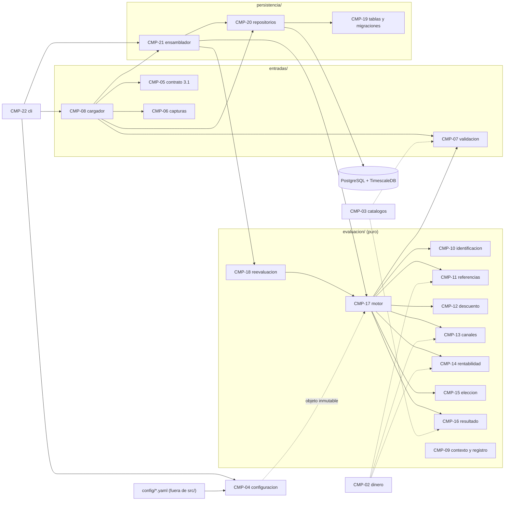
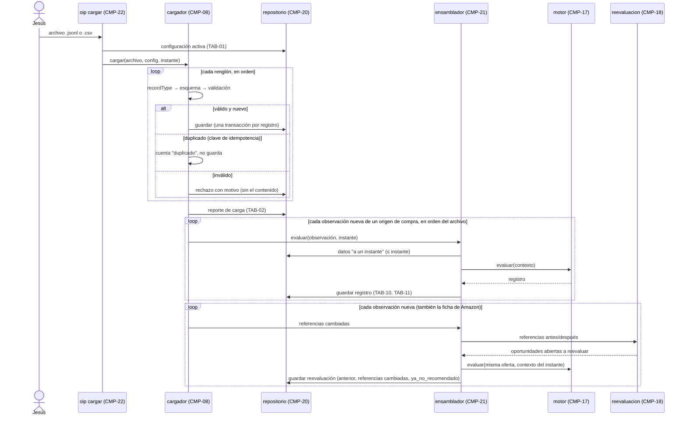

# Design

Diseño de la parte B del REQ-2026-0001 v2.9 (evaluación de oportunidades). El **qué** está en `proposal.md` y en las cinco specs; este documento dice **cómo** se construye, qué se crea, dónde vive cada parámetro y qué se prueba en cada nivel. Lo escribe `oip-disenador` (DEC-229).

Convención de identificadores, para que `tasks.md` cite lo que construye: `CMP-xx` componente, `TAB-xx` tabla, `CTR-xx` contrato o esquema, `PAR-xx` sección de la configuración versionada, `RNF-n` requisito no funcional de `proposal.md`.

## Context

- **Repo vacío.** Solo existen `src/oip/__init__.py`, `tests/test_arranque.py`, `pyproject.toml` (Python ≥ 3.12, pytest con `--strict-markers` y el marcador `scenario`, ruff con `S` y `DTZ`), el gate `scripts/check-egress.sh` y el workflow `gates.yml` (ruff, pytest, egress, bandit, pip-audit, OpenSpec, trazabilidad). No hay código que reutilizar: este cambio crea los primeros paquetes, así que el orden es **crear lo mínimo** y dejar puntos de extensión para A, C y D.
- **La parte B no consulta comercios** (DEC-082, DEC-173, DEC-194). Sus entradas son archivos (JSON Lines y CSV) y la configuración versionada (REQ §3.2.6).
- **El gate de egress** falla si `src/` menciona dominios de comercios: por eso la configuración con dominios vive **fuera de `src/`** (`config/`).
- **CI sin base de datos.** `gates.yml` no levanta PostgreSQL; las pruebas que necesitan base se marcan y se saltan en CI (ver Estrategia de pruebas y Pregunta 6).
- **Fuentes que mandan:** REQ v2.9 (§3.2, §5, §6, §7, §10 a §13), RN en las versiones congeladas (DEC-209), arquitectura v2.2 (§2, §5, §7, §8, §9, §10, ADR) y DEC-197 a DEC-229. Donde la arquitectura v2.2 no recoge una decisión del REQ (riesgo R-05: DEC-197, 198, 201, 204, 206, 226 y 227 b), manda el REQ y este diseño lo cita.

## Goals / Non-Goals

**Goals**
- Un **motor de evaluación puro** (sin I/O ni reloj) que recibe un contexto y devuelve el registro de evaluación de REQ §7; probado escenario por escenario sin base de datos.
- Entradas de B: cargador único de JSON Lines y CSV con validación por `recordType`, reporte de carga y modelo de las dos familias de capturas (§6).
- Configuración versionada sin valores fijos en el código, con la versión guardada en cada evaluación.
- Persistencia en PostgreSQL + TimescaleDB con migraciones versionadas, y reproducibilidad de cada evaluación desde su registro.
- Reevaluación de oportunidades abiertas con "ya no recomendado" como dato para la parte C.

**Non-Goals** (de diseño; el alcance funcional está en `proposal.md`)
- Sin servicio HTTP en B: no hay FastAPI ni API (la API de solo lectura es de C, DEC-218). B se opera con una CLI.
- Sin cola de tareas: B evalúa en el mismo proceso de la carga; la cola en PostgreSQL (ADR-010, DEC-176) llega con la ingesta de la parte A.
- Sin avisos, tablero ni etiquetas en español de los códigos: son de C (B guarda códigos).
- Sin compresión, agregados continuos ni retención de TimescaleDB: B crea las hypertables; las políticas llegan con el volumen de la parte A (Pendiente 8).
- Sin tabla `opportunity` con estados: en B, "oportunidad abierta" es una consulta (`TAB-12`); los estados (alertada, comprada…) son de C.

## Decisions

### 1. Componentes y límites entre módulos

Paquete `oip` en `src/oip/`. Todo vive en el **Core** (DEC-120, DEC-173): ningún módulo tiene clientes HTTP, spiders ni navegadores, y ninguno conoce dominios de comercios (los recibe de la configuración).

| ID | Componente (ruta) | Hace | No hace | Depende de |
|---|---|---|---|---|
| CMP-01 | Estructura del paquete: `src/oip/` con los subpaquetes `entradas/`, `evaluacion/`, `persistencia/`; dependencias en `pyproject.toml`; marcadores de pytest | Fija la estructura y las dependencias de §5 de este diseño | Lógica | — |
| CMP-02 | `oip/dinero.py` | Montos con `Decimal`: lectura desde texto, redondeo `ROUND_HALF_UP` a centavos **solo** de la lista cerrada (§8), porcentajes sin redondear y su formato a 1 decimal | Fórmulas de negocio | — |
| CMP-03 | `oip/catalogos.py` | Enums cerrados (§9): resultados, motivos en su orden, marcas, causas de canal, estados, niveles, calidad, confianza, `recordType`, códigos del contrato 3.1, referencias de precio | Decidir resultados | — |
| CMP-04 | `oip/configuracion.py` | Esquema de la configuración (§7), carga desde YAML, validación estricta, huella `sha256` y versión; entrega un objeto inmutable | Leer comercios; guardar en base (lo hace CMP-20) | CMP-02, CMP-03 |
| CMP-05 | `oip/entradas/contrato.py` | Modelo de la observación del contrato de ingesta 3.1 (arquitectura §8) y las reglas de B sobre la publicación de un particular (DEC-227 b) | Validar contra la configuración (CMP-07) | CMP-02, CMP-03 |
| CMP-06 | `oip/entradas/capturas.py` | Esquemas de las 7 capturas que no son observaciones (CTR-04), con sus obligatorios | Persistir | CMP-02, CMP-03 |
| CMP-07 | `oip/entradas/validacion.py` | Paso 1 de REQ §3.2: valida una observación contra el contrato y la configuración y devuelve el primer motivo de rechazo | Evaluar | CMP-04, CMP-05 |
| CMP-08 | `oip/entradas/cargador.py` | Lee JSON Lines y CSV, toma y quita `recordType`, despacha a CMP-05/CMP-06/CMP-07, rechaza por registro sin detener la carga, arma el reporte de carga y, al final, pide la evaluación de cada observación nueva de un origen de compra | Calcular referencias ni márgenes | CMP-05 a CMP-07, CMP-20, CMP-21 |
| CMP-09 | `oip/evaluacion/contexto.py` | Tipos inmutables del dominio: `ContextoEvaluacion` (todo lo que el motor necesita, ya leído) y `RegistroEvaluacion` (REQ §7), con serialización JSON canónica y estable | Leer la base | CMP-02, CMP-03 |
| CMP-10 | `oip/evaluacion/identificacion.py` | Paso 2: coincidencia (RN-013, dígito verificador del GTIN), estado (RN-014, S-13), vendedor y riesgos (RN-015, S-21), lista "evitar siempre", confianza de la disponibilidad (RN-007, S-25) | Precios | CMP-04, CMP-09 |
| CMP-11 | `oip/evaluacion/referencias.py` | Paso 3: precio habitual (una por publicación y día, mediana, historial suficiente) y **episodio de liquidación**; precio de mercado hoy con **comercio = cadena**; precio de venta esperado y mínimo de 60 días en Amazon; MSRP (solo se muestra); valor de referencia de usados (RN-014). Implementa la interfaz `FuentePrecios` (`PriceReferenceSource` de la arquitectura §2.2) con la fuente `historial_propio` | Descuento ni márgenes | CMP-04, CMP-09 |
| CMP-12 | `oip/evaluacion/descuento.py` | Pasos 4 y 5: descuento anunciado y real, franja, marcas de RN-003 y calidad del precio (RN-012, S-22, S-28; "no aplica" en usados) | Canales | CMP-11 |
| CMP-13 | `oip/evaluacion/canales.py` | Pasos 6 a 8: costo de compra (impuesto por `taxLocation`, recogida), **estado de cada canal** (§3.2.1, con la concurrencia de S-31), canal Amazon (ranking de DEC-206, demanda RN-004, comisión, envío, empaque, restricción RN-006) y venta local (precio RN-016, demanda RN-017, entrega RN-008) | Elegir canal | CMP-02, CMP-04, CMP-11, CMP-12 |
| CMP-14 | `oip/evaluacion/rentabilidad.py` | Por canal: margen neto y ajustado (RN-001, RN-005), castigo, devoluciones, unidades, días, rendimiento, nivel (RN-009 §4.2 y §4.3, mínimo por unidad), `nivel_calculado` (DEC-202, DEC-224 a) y baja por competencia más barata | Estado del canal | CMP-02, CMP-13 |
| CMP-15 | `oip/evaluacion/eleccion.py` | Paso 9: canal elegido (RN-018) y **nivel del aviso** con su canal (S-33, DEC-219, DEC-221) | Avisar | CMP-14 |
| CMP-16 | `oip/evaluacion/resultado.py` | Paso 10: reúne **todos** los motivos de §3.2.3 y aplica la precedencia de §3.2.4; motivo principal | Calcular números | CMP-03 |
| CMP-17 | `oip/evaluacion/motor.py` | Orquesta los pasos 1 a 11 sobre un `ContextoEvaluacion` y devuelve el `RegistroEvaluacion`. **Puro**: sin base, sin reloj (recibe `instante`), sin red | Persistir | CMP-07, CMP-09 a CMP-16 |
| CMP-18 | `oip/evaluacion/reevaluacion.py` | Detecta qué referencias cambió una observación nueva (§3.2.5), decide qué oportunidades abiertas se reevalúan y calcula "ya no recomendado" (DEC-204, DEC-224 c) | Leer la base (recibe datos) | CMP-09, CMP-11, CMP-17 |
| CMP-19 | `oip/persistencia/tablas.py` y `migrations/` (Alembic, en la raíz del repo) | Metadatos de SQLAlchemy Core de §4 y migraciones versionadas `0001` (esquema) y `0002` (hypertables) | Consultas de negocio | CMP-01 |
| CMP-20 | `oip/persistencia/repositorios.py` | Interfaz `Repositorio` (Protocol) con dos implementaciones: `RepositorioMemoria` (pruebas y desarrollo) y `RepositorioPostgres`. Guarda y lee observaciones, capturas, versiones de configuración, cargas y evaluaciones | Decidir | CMP-09, CMP-19 |
| CMP-21 | `oip/persistencia/ensamblador.py` | Servicio de evaluación: arma el `ContextoEvaluacion` desde el repositorio "a un instante", llama al motor, guarda el registro y dispara la reevaluación; recalcula una evaluación desde su registro (RNF-3) | Reglas de negocio | CMP-17, CMP-18, CMP-20 |
| CMP-22 | `oip/cli.py` (entrada `oip` en `pyproject.toml`) | `oip config cargar <archivo>`, `oip cargar <archivo> [--instante]`, `oip evaluacion recalcular <id>` (CTR-07) | Lógica propia | CMP-04, CMP-08, CMP-21 |
| CMP-23 | `deploy/` | `Containerfile` del Core, Quadlets de `oip-db` y del contenedor de migraciones, uso de `podman secret`, sección del runbook (DEC-183) | — | CMP-19, CMP-22 |

**Reutiliza, extiende, crea:** no hay código previo. Se crean 23 componentes, pero el motor queda en 9 módulos pequeños de `evaluacion/` (uno por paso o grupo de pasos de §3.2) para que cada tarea toque pocos archivos. Regla para las tareas: un módulo que pase de ~400 líneas se divide en un subpaquete con el mismo nombre, sin cambiar su interfaz.

### 2. Flujo de una carga

Solo este flujo no es obvio (quién evalúa, en qué orden y en qué transacción):

- Las evaluaciones se hacen **después** de cargar todo el archivo, para que una captura del mismo archivo (un comparable, un estimado) ya cuente. El orden es el del archivo.
- Una observación inválida de tipo `observation` deja su rechazo en el reporte **y** un registro de evaluación `RECHAZADA_VALIDACION` con su motivo (B20), sin guardar la observación en el historial. Un renglón sin `recordType` o con tipo desconocido solo queda en el reporte (B34 c).
- Una ficha de Amazon (`amazonListing` no nulo) no se evalúa como oferta (DEC-203): solo puede disparar reevaluaciones.

### 3. El motor y el instante

- `motor.evaluar(contexto) -> RegistroEvaluacion` es una función pura. El contexto trae: la observación de la oferta, las observaciones del producto hasta el instante (90 días: 60 de ventana más 30 de episodio), las fichas de Amazon (60 días), los comparables, estimados, MSRP y demanda local vigentes, la versión de configuración (contenido completo) y el `instante`.
- **`instante`** = momento en que corre la evaluación (la carga, o la observación que dispara una reevaluación). Lo recibe el motor; la CLI lo toma del reloj o de `--instante` (para reproducir datos guardados). Nada posterior al instante entra al contexto.
- **Día evaluado** = día calendario del `instante` en la zona de `PAR-01` (`America/Tijuana`, Pendiente 5). Con él se calculan "hoy", la ventana de 60 días anterior **sin** ese día (DEC-224 b) y los 7 días del ranking.
- **Antigüedad** de la disponibilidad (RN-007) = `instante − extractedAt` de la observación de la oferta.
- Orden interno, igual a REQ §3.2: validar → identificar → referencias → descuento → calidad → costo de compra → estado y números de cada canal → nivel (antes que las unidades, porque el tope depende del nivel) → unidades, días y rendimiento → elección y nivel del aviso → motivos y precedencia → registro.

### 4. Modelo de datos (PostgreSQL + TimescaleDB)

Nombres de tablas y columnas en inglés, como la arquitectura §7.1 (que los deja como propuesta para este diseño). Montos `numeric(12,2)`; precios convertidos de MXN y medianas sin redondear `numeric(14,4)`; tiempos `timestamptz` en UTC; códigos cerrados como `text` con `CHECK` contra el catálogo.

| ID | Tabla | Columnas principales | Claves e índices |
|---|---|---|---|
| TAB-01 | `config_version` | `id` bigserial, `version` text (la del archivo), `sha256` char(64), `schema_version` text, `content` jsonb (completo), `source_file` text, `loaded_at` | PK `id`; únicos `version` y `sha256`. La activa es la de `loaded_at` más reciente ≤ instante |
| TAB-02 | `load_run`, `load_rejection` | `load_run`: `id` uuid, `file_name`, `file_sha256`, `format` (`jsonl`/`csv`), `record_type` (CSV), `started_at`, `finished_at`, `loaded`, `rejected`, `duplicates`, `rejected_by_reason` jsonb, `config_version_id`. `load_rejection`: `load_run_id`, `line_number`, `record_type` null, `reason`, `field` null | PK `load_run.id`; `load_rejection` PK (`load_run_id`, `line_number`). **Sin el contenido del renglón** (R-20, DEC-181) |
| TAB-03 | `product`, `product_identifier` | `product`: `id` uuid, `brand`, `model`, `content`, `category`, `created_at`. `product_identifier`: `product_id`, `kind` (`gtin`, `brand_model`, `retailer_sku`, `asin`), `value` (normalizado) | Único (`kind`, `value`). El estado (`condition`) va en la observación, no en el producto: los filtros "nuevo" y "mismo estado" se aplican al leer |
| TAB-04 | `listing` | `id` uuid, `product_id`, `retailer_code`, `store_code` null, `canonical_url`, `platform` null (particulares), `pickup_location` null, `first_seen_at` | Único (`retailer_code`, `canonical_url`, `coalesce(store_code,'')`); índice `product_id`. La publicación de un particular es un `listing` con `retailer_code = 'particular'` (DEC-223); no hay tabla `private_listing` |
| TAB-05 | `price_observation` *(hypertable)* | `observation_id` uuid, `observed_at` (= `extractedAt`), `listing_id`, `product_id`, `price`, `was_price`, `currency`, `seller`, `condition`, `purchase_mode`, `is_clearance`, `tax_location`, `shipping_to_me`, `weight_kg`, `dims_cm` jsonb, `category`, `title`, `identification` (`confirmed`/`unconfirmed`), `msrp_value`, `msrp_source`, `msrp_date`, `schema_version`, `load_run_id` | PK (`observation_id`, `observed_at`); índices (`product_id`, `observed_at` desc) y (`listing_id`, `observed_at` desc) |
| TAB-06 | `availability_observation` *(hypertable)* | `observation_id`, `observed_at`, `listing_id`, `store_code`, `state`, `quantity`, `text`, `scope`, `add_to_cart` | PK (`observation_id`, `observed_at`); índice (`listing_id`, `observed_at` desc) |
| TAB-07 | `amazon_listing_observation` *(hypertable)* | `observation_id`, `observed_at`, `product_id`, `listing_id`, `buy_box_price` null, `sellers_new`, `rank_main`, `rank_sub`, `reviews`, `bought_last_month` | PK (`observation_id`, `observed_at`); índice (`product_id`, `observed_at` desc) |
| TAB-08 | `ingest_receipt` | `idempotency_key` text, `observation_id`, `source` (`file`/`worker`), `received_at`, `load_run_id` | PK `idempotency_key` (arquitectura §8) |
| TAB-09 | Capturas: `local_comparable`, `local_estimate`, `msrp_capture`, `local_demand`, `store_visit`, `opportunity_outcome` (`recordType: actual_result`), `client_request` | Columnas = campos de CTR-04 en snake_case, más `id` uuid, `product_id` (si el tipo trae producto), `load_run_id`, `idempotency_key` y `captured_at`. `local_comparable` guarda además `price_usd` numeric(14,4) (convertido con el tipo de cambio, S-23) | Único `idempotency_key` en cada una; índices (`product_id`, `condition`) en comparables y estimados; (`category`, `captured_on` desc) en demanda local |
| TAB-10 | `evaluation` | `id` uuid, `evaluated_at` (= instante), `offer_observation_id` null (null en un rechazo), `listing_id`, `product_id`, `config_version_id`, `rn_versions` jsonb, `result`, `main_reason`, `reasons` text[], `rejection_reason`, `marks` text[], `price_quality`, `confidence`, `identification`, `references` jsonb (habitual con su fuente y episodio, mercado hoy, MSRP, mínimo de 60 días, venta esperada en Amazon), `advertised_discount`, `real_discount` numeric (sin redondear), `purchase_cost`, `chosen_channel`, `alert_level`, `alert_channel`, `observations_used` jsonb (id y fecha), `input_snapshot` jsonb (CTR-06), `previous_evaluation_id` null, `changed_references` text[], `no_longer_recommended` bool, `load_run_id` | PK `id`; índices (`listing_id`, `evaluated_at` desc), (`product_id`, `result`) |
| TAB-11 | `evaluation_channel` | `evaluation_id`, `channel` (`amazon`/`local`), `state`, `closed_causes` text[], `review_causes` text[], `sale_price`, `selling_cost`, `net_margin`, `net_margin_pct`, `returns_cost`, `drop_penalty`, `adjusted_margin`, `adjusted_margin_pct`, `units`, `days_to_recover`, `monthly_yield_pct`, `level`, `calculated_level`, `total_profit`, `marks` text[] | PK (`evaluation_id`, `channel`) |
| TAB-12 | Vista `open_opportunity` | La evaluación más reciente de cada `listing` con `result = 'NIVEL_ASIGNADO'` (§3.2.5) | Usa el índice de TAB-10 |

- **Registro de evaluación (REQ §7), campo por campo:** identificador (`id`), fecha (`evaluated_at`), observaciones usadas con su fecha (`observations_used`), valores por canal (TAB-11), estado de cada canal (`state`, causas), calidad del precio, marcas, todos los motivos, motivo principal, `nivel_calculado` por canal, canal elegido, nivel del aviso (`alert_level`) y su canal (`alert_channel`, para el cuerpo del aviso de S-33), resultado, versión de cada RN (`rn_versions`, de PAR-01) y de la configuración (`config_version_id`); en una reevaluación, la evaluación anterior y las referencias que cambiaron. El **reporte de carga** de cada archivo es TAB-02.
- **Migraciones** (ADR-028, DEC-179): `0001_esquema` crea TAB-01 a TAB-12 como tablas normales, con claves primarias que ya incluyen el tiempo; `0002_hypertables` convierte TAB-05 a TAB-07 con `create_hypertable` (intervalo de chunk en la migración, 7 días). La `0002` pasa por la PoC de DEC-179 en T23 antes de producción. Nunca se edita una migración aplicada.

### 5. Acceso a datos

- **SQLAlchemy 2 Core** (tablas y consultas explícitas, sin ORM) con **psycopg 3**, y **Alembic** para las migraciones. Por qué: SQL visible (hypertables, `numeric` → `Decimal` sin pasar por `float`, consultas por ventana de tiempo), sin la sesión implícita de un ORM que esconda las transacciones. Alternativas: ORM (más magia de la que pide un motor puro), SQL a mano con un migrador propio (reinventa Alembic).
- **Repositorio con dos implementaciones** (CMP-20). El motor no ve el repositorio: recibe el contexto ya leído. `RepositorioMemoria` permite correr los 54 escenarios y la carga en CI sin base; `RepositorioPostgres` se prueba con **la misma batería de pruebas de contrato** que la de memoria (pruebas de integración).
- **Transacciones:** un registro de un archivo = una transacción (un error no deshace los demás, "no detiene la carga"); cada evaluación y su registro = una transacción; el reporte de carga se escribe al final, en su propia transacción.
- **Idempotencia de la carga:** observación → `idempotencyKey` del contrato si viene; si no, `retailerCode|canonical_url|storeCode|extractedAt` (arquitectura §8), guardada en TAB-08. Captura → huella `sha256` del registro normalizado (tipo + campos). Un duplicado no se guarda ni se evalúa otra vez; el reporte lo cuenta aparte como `duplicados` (Pendiente 4).
- **Conexión:** la URL sin contraseña sale del entorno (`OIP_DATABASE_URL`); la contraseña, del archivo del `podman secret` montado (`/run/secrets/oip_db_password`). Nunca se registra la URL completa.
- **Consulta "a un instante":** toda lectura del ensamblador filtra `observed_at ≤ instante` y `loaded_at ≤ instante` (configuración), para que una evaluación reproduzca lo que se sabía en ese momento.

Dependencias nuevas (las agrega T01; ninguna es cliente HTTP): `pydantic>=2.9` (esquemas de contrato, capturas y configuración), `PyYAML>=6.0` (configuración), `SQLAlchemy>=2.0`, `psycopg[binary]>=3.2`, `alembic>=1.14`, `tzdata` (zonas horarias en Windows).

### 6. Contratos y esquemas

| ID | Contrato | Definición |
|---|---|---|
| CTR-01 | Observación: **contrato de ingesta 3.1** de la arquitectura v2.2 §8 | Se **cita, no se redefine** (DEC-199, DEC-223). B acepta `schemaVersion` `3.1`, `3.0` (N-1, ADR-027) o ausente (se toma 3.1). Además del contrato, la publicación de un particular exige `pickupLocation`, `brand` y `model` (DEC-227 b) y su `title` lo arma el Core con `brand` + `model`, ignorando el que venga (DEC-212). En una ficha de Amazon, las referencias usan `amazonListing.buyBoxPrice`; `price.current` se valida como dice el contrato (Pendiente 3) |
| CTR-02 | Archivo **JSON Lines** | UTF-8, un objeto por renglón. Cada renglón lleva `recordType` (DEC-227 a); el cargador lo lee y lo quita antes de validar. Se lee con `parse_float=Decimal` para que ningún número pase por `float`. Admite tipos mezclados |
| CTR-03 | Archivo **CSV** | UTF-8, separador coma, encabezado obligatorio, un archivo por tipo. **El tipo sale del nombre del archivo**: `<recordType>.csv` o `<recordType>__<sufijo>.csv` (por ejemplo `local_comparable__2026-11-18.csv`); un nombre sin tipo conocido rechaza cada renglón con `TIPO DE REGISTRO DESCONOCIDO`. Encabezados = nombres de campo de CTR-01 o CTR-04; los campos anidados del contrato con punto (`price.current`, `availability.state`); listas separadas por `\|`; celda vacía = campo ausente. Enteros y booleanos los convierte el cargador desde el texto (T08): los esquemas son estrictos (DEC-238). **Zona horaria:** en una observación, `extractedAt` y las demás horas del contrato 3.1 llevan desfase (sin él → `CAMPO OBLIGATORIO FALTANTE (<campo>)`); en una captura de CTR-04, una fecha y hora sin desfase se toma en la zona de `general.timezone` (PAR-01, `America/Tijuana`) (DEC-240) |
| CTR-04 | **Capturas** (REQ §6, familia 2): nombres y tipos | Ver la tabla siguiente. Campos en inglés y camelCase, como el contrato; códigos en inglés y snake_case (DEC-199). Una fecha y hora sin desfase (`visitedAt`) se toma en la zona de `general.timezone` (PAR-01, `America/Tijuana`), que el cargador pasa al esquema; con desfase, se conserva el suyo (DEC-240). Enteros y booleanos estrictos (DEC-238) |
| CTR-05 | **Reporte de carga** | `{loadRunId, fileName, format, recordType, loaded, rejected, duplicates, rejectedByReason: {<motivo>: n}, rejections: [{line, recordType, reason}], citiesToRegister: [<código>]}`. `citiesToRegister` pide dar de alta las ciudades de `CIUDAD NO CONFIGURADA` (REQ §6). Sin contenido de los renglones |
| CTR-06 | **Registro de evaluación** serializado (`input_snapshot` y salida) | JSON canónico: claves ordenadas, montos y porcentajes como texto decimal, fechas ISO 8601 en UTC, enums por su código. `input_snapshot` = el `ContextoEvaluacion` completo más `config_version_id`; recalcular = deserializar, evaluar y comparar con el registro guardado |
| CTR-07 | **CLI** | `oip config cargar <archivo.yaml>` (registra una versión; idempotente por `sha256`); `oip cargar <archivo> [--instante ISO]` (imprime el reporte CTR-05); `oip evaluacion recalcular <id>` (sale con 0 si coincide, 1 y la diferencia si no) |

**Esquemas de CTR-04** (obligatorios = REQ §6; los opcionales los agrega este diseño):

| `recordType` | Campos (tipo) | Obligatorios | Reglas |
|---|---|---|---|
| `local_comparable` | `gtin` (text), `brand` (text), `model` (text), `condition` (código), `askingPrice` (decimal), `currency` (`USD`/`MXN`), `exchangeRate` (decimal, MXN por USD), `city` (código de PAR-09), `date` (fecha), `sold` (bool) | producto (`gtin`, o `brand` y `model`), `condition`, `askingPrice`, `currency`, `exchangeRate` si `currency = MXN`, `city`, `date`, `sold` | `price_usd = askingPrice ÷ exchangeRate` sin redondear (S-23); `askingPrice > 0` o `PRECIO INVÁLIDO`; ciudad fuera de la lista → `CIUDAD NO CONFIGURADA` |
| `local_estimate` | `gtin`, `brand`, `model`, `condition` (opcional), `price` (USD), `date` | producto, `price`, `date` | Sin `condition`, vale para cualquier estado del producto; con `condition`, solo para ese estado. Vale el más reciente |
| `msrp` | `gtin`, `brand`, `model`, `value` (USD), `source` (text), `date` | producto, `value`, `source`, `date` | Solo se muestra (DEC-218) |
| `local_demand` | `category` (código), `level` (`low`/`medium`/`high`), `date` | los tres | Vale la más reciente por categoría; sin captura, la inicial de PAR-04 |
| `store_visit` | `storeCode`, `gtin`/`brand`/`model` o `evaluationId`, `result` (`found`/`not_found`/`different_price`/`confirmed_by_call`), `visitedAt` (fecha y hora) | tienda, producto u oportunidad, `result`, `visitedAt` | B la guarda; la usa C (RN-007) |
| `actual_result` | `evaluationId`, `channel` (`amazon`/`local`), `units` (int), `purchasePrice`, `salePrice`, `actualCosts` (decimal), `purchasedOn`, `soldOn` (fecha) | todos | Se guarda en `opportunity_outcome`; la usa C |
| `client_request` | `clientAlias` (text), `items` (lista de 1 a 3 modelos o códigos), `quantity` (int ≥ 1), `acceptedConditions` (lista de códigos; por defecto `[new]`), `modality` (`link_only`/`buy_and_deliver`), `postalCode` (opcional), `date` | `clientAlias`, `items`, `quantity`, `modality`, `date` | **Sin campo de notas** (RNF-11, Pendiente 10). El alias nunca se escribe en logs. `acceptedConditions` es opcional: ausente o vacío → `[new]` (RN-011 punto 2, REQ §3.4 punto 1; DEC-241) |

- **Motivo de un obligatorio faltante:** `CAMPO OBLIGATORIO FALTANTE (<campo>)` con el **nombre del campo tal como va en el archivo**, también en las capturas (REQ B34: "el nombre del campo en el motivo lo fija el `design.md`"). Así, B34 (a) da `CAMPO OBLIGATORIO FALTANTE (exchangeRate)` (el "tipo de cambio" del REQ) y B34 (b) `CAMPO OBLIGATORIO FALTANTE (condition)` (el "estado"); B20 da `(category)`, `(pickupLocation)` y `(model)`. Si falta el producto, se cita `gtin` cuando no hay `brand` ni `model`, si no el que falte de los dos.
- **Orden de las comprobaciones** (el primer fallo es el motivo, uno por registro): `recordType` → obligatorios del contrato (en el orden de la arquitectura §8) → obligatorios del particular (`pickupLocation`, `brand`, `model`) → precio > 0 con 2 decimales como máximo (`PRECIO INVÁLIDO`) → dominio del comercio o enlace `https` de una plataforma permitida (`DOMINIO NO AUTORIZADO`; los comercios aceptan `http` o `https`, arquitectura §10) → ciudad (`CIUDAD NO CONFIGURADA`). Un código fuera de las tablas cerradas usa `CAMPO OBLIGATORIO FALTANTE (<campo>)` (Pendiente 2).
- **Campos desconocidos:** se descartan sin guardarlos ni registrarlos (así una descripción libre o un teléfono no llegan a la base, R-20).

### 7. Configuración versionada

- **Un archivo YAML** por versión, con `version` (texto, por ejemplo `2026-11-18.1`) y `schemaVersion`. Vive en `config/` (fuera de `src/`, por el gate de egress), se monta en el contenedor y **no** va dentro de la imagen: cambiar un parámetro = editar el archivo y `oip config cargar`, sin desplegar código (RNF-2).
- `oip config cargar` valida el archivo completo contra el esquema (pydantic, estricto: un parámetro faltante, un tipo inválido o una sección desconocida rechazan el archivo entero, sin cargar nada), calcula su `sha256` y guarda el contenido completo en TAB-01. **No hay valores por defecto en el código**: todo número de las reglas sale del archivo.
- Cada evaluación guarda `config_version_id`; al recalcularla se usa ese contenido exacto (RNF-3).
- Dos archivos en el repo: `tests/fixtures/config/base.yaml`, la **configuración base de los escenarios** (REQ §5, con sus "—" y la tienda a 7.75%), y `config/oip-config.yaml`, la **inicial de producción** (REQ §5 más los valores de las RN, con su fuente en comentarios; Pendiente 7). Las partes A, C y D agregan sus secciones con un `schemaVersion` nuevo.

| ID | Sección | Parámetros (REQ §5, §6 y RN) |
|---|---|---|
| PAR-01 | `general` | Zona horaria del día calendario; moneda (`USD`); cuenta de Amazon (`new`/`established`, para los días de pago); versión de cada RN (`RN-001: v2` … `RN-018: v1`), que se copia a cada evaluación |
| PAR-02 | `retailers` | Por código: cadena, dominios autorizados, si es la ficha de Amazon. (Activo/pausado, términos, robots y stealth son de la parte A.) |
| PAR-03 | `stores` | Por `storeCode`: comercio y límite de unidades por cliente. (Km, tiempo, zona: parte C.) |
| PAR-04 | `categories` | Por código de `category`: comisión (`flat`, `total_threshold` o `tiers`, con el mínimo de $0.30 por unidad), tasa de devolución propia o **asignada** de otra categoría (marca `ESTIMADO (devolución)`), pérdida por devolución, restricción en Amazon, tamaño de la categoría principal (umbral de demanda = tamaño × porcentaje de PAR-11; sin tamaño → `DEMANDA DESCONOCIDA`, DEC-225), límite de subcategoría (relojes, joyería), demanda local inicial, riesgo de procedencia. Un "—" del REQ §5 = clave ausente |
| PAR-05 | `lists` | Marcas y productos restringidos en Amazon; evitar siempre (por identificador de producto); marcas de lujo (S-21); material peligroso; temporada de juguetes (S-10, fechas) |
| PAR-06 | `shipping` | Rangos por peso con envío FBM y empaque; envío y empaque sin peso ($14 y $2, S-06); límite de peso para cotizar (6 kg); cotizaciones capturadas por producto; envío hacia mí por defecto ($0) |
| PAR-07 | `taxes` | Por `taxLocation`: tasa, fuente (CDTFA) y fecha de vigencia; tasa de respaldo (7.75%, DEC-220); particulares sin impuesto (S-14) |
| PAR-08 | `price_reference` | Ventana del habitual (60 días), historial suficiente (5 en 3 días), límite del episodio (30 días), antigüedad del mercado hoy (48 h), ventana del precio típico de la tienda (60 días) |
| PAR-09 | `private_sellers` | Plataformas permitidas (código, dominios, prefijo de ruta opcional; OfferUp y Facebook Marketplace, DEC-212); ciudades (`pickupLocation`): código, km y tiempo de recogida, y si están en la zona de venta local (RN-016, DEC-171) |
| PAR-10 | `discount_quality` | Franjas del descuento real (20% / 25%), factor de inflado (1.5); calidad RN-012 (15%, 2%, 90 días, 2 comercios) |
| PAR-11 | `amazon` | Demanda RN-004 (0.5%, 20 vendedores, 100 en subcategoría, 50% de empeoramiento); ranking (7 días, DEC-206); días de venta por ranking (cortes 10,000 / 50,000; 7 / 21 / 45); días de pago (30 / 21); castigo (50%; 10% sin mínimo, S-05); tope de primera compra (3; 5 con ranking < 10,000 y Comprar ya o Muy recomendable); máximo 2 unidades sin ventas al mes; otros costos de venta ($0) |
| PAR-12 | `local_sale` | Precio local (85% del mercado hoy, 10% de negociación; usados 100% del valor de referencia); usados (3 comparables, 85% de los pedidos); demanda local (7 / 14 días por unidad; competencia > 10); tasa de devolución local (0%); traslados ($/km, $/h; entrega por defecto 10 km y 0.5 h = $9.50, S-24) |
| PAR-13 | `levels` | Niveles RN-009 (descuento y margen ajustado por nivel; tipo de aviso de cada uno: inmediato, resumen o tablero, para "nivel con aviso"); mínimo por unidad ($10 / 10% del costo); competencia más barata (15%); confianza RN-007 (ventanas normales y en liquidación, "pocas unidades"); desempate de canal (10%) |

Los supuestos que cambian la lógica (R-03) quedan como **parámetros o tablas** de esta configuración cuando son valores (S-05, S-08, S-27, S-31…), y como funciones con nombre propio en su módulo cuando son reglas, citando el supuesto en el docstring, para cambiarlas en un solo lugar tras la sesión 3.

### 8. Dinero

- **Un solo lugar:** `oip/dinero.py` (CMP-02) tiene el enum `TipoMonto` con la **lista cerrada** de REQ §5 / DEC-207: impuesto, costo de compra, comisión, envío, devoluciones, castigo, precio de venta local, valor de referencia de usados, costos de traslado (entrega, recogida, viaje), margen neto, margen ajustado y ganancia total. Única función que redondea: `redondear(tipo: TipoMonto, valor: Decimal) -> Decimal`, con `ROUND_HALF_UP` a `0.01` (en negativos el medio centavo se aleja de cero, que es lo que hace `ROUND_HALF_UP`). Ningún otro módulo llama a `quantize`.
- **Una vez por fórmula:** cada monto de la lista se calcula con su fórmula completa sin redondeos intermedios y se redondea al final (B33: 100.15 × 85% × 90% = 76.614750 → 76.61); una fórmula que combina montos de la lista usa los ya redondeados (neto = venta − costo de compra − costo de venta, como en B1). El precio habitual, las medianas, el precio convertido de MXN y los porcentajes **no** se redondean (DEC-226 b).
- **Porcentajes:** `Decimal` sin redondear para calcular y comparar; `formatear_porcentaje(p)` a 1 decimal solo para mostrar.
- **Sin `float`:** los montos se leen desde texto (`Decimal("29.00")`); un `float` que llegue a `dinero.py` levanta `TypeError`. Los JSON se leen con `parse_float=Decimal` y la configuración se valida a `Decimal`.

### 9. Catálogos cerrados (CMP-03)

| Catálogo | Valores (código) | Orden o precedencia |
|---|---|---|
| Resultado | `RECHAZADA_VALIDACION`, `DESCARTADA`, `SOLO_REFERENCIA`, `REVISION_MANUAL`, `SIN_NIVEL`, `NIVEL_ASIGNADO` | §3.2.4: DESCARTADA > SOLO_REFERENCIA > REVISION_MANUAL > (NIVEL_ASIGNADO o SIN_NIVEL) |
| Motivo de rechazo | `PRECIO INVÁLIDO`, `DOMINIO NO AUTORIZADO`, `CAMPO OBLIGATORIO FALTANTE (<campo>)`, `CIUDAD NO CONFIGURADA`, `TIPO DE REGISTRO DESCONOCIDO` | Orden de comprobación de §6 |
| Motivo (§3.2.3) | `EVITAR`, `MERCADO YA BARATO`, `SIN CANAL DISPONIBLE`, `MARGEN NEGATIVO`, `SOLO REFERENCIA`, `SIN HISTORIAL SUFICIENTE`, `SIN REFERENCIA DE USADOS`, `COINCIDENCIA NO CONFIRMADA`, `VENDEDOR EXTERNO`, `PARTICULAR`, `RIESGO DE PROCEDENCIA`, `DEMANDA DESCONOCIDA` | En este orden; cada uno con su "lleva a". El principal es el primero que aplica |
| Marca | `PRECIO ANTES INFLADO`, `DESCUENTO ANUNCIADO NO COMPROBADO`, `DEMANDA A LA BAJA`, `COMPETENCIA MÁS BARATA`, `SIN OFERTA HOY`, `MATERIAL PELIGROSO`, `REVISAR RETIROS`, `SIN COMPARABLES LOCALES`, `CONFIANZA BAJA`, `ESTIMADO (<dato>)`, `MARGEN ESTIMADO`, `EMPAQUE POR CONFIRMAR` | No cambian el resultado |
| Causa de canal cerrado | Amazon: `SIN PRECIO DE VENTA EN AMAZON`, `DEMANDA INSUFICIENTE EN AMAZON`, `NO VENDIBLE EN AMAZON (POR AHORA)`, `COMISIÓN DESCONOCIDA`, `TASA DE DEVOLUCIÓN DESCONOCIDA`, `ENVÍO POR COTIZAR`, `PRODUCTO NO NUEVO`, `SIN ROTACIÓN`. Local: `DEMANDA LOCAL BAJA`, `SIN PRECIO LOCAL`, `SIN ROTACIÓN` | Se registran también como marcas (§3.2.3). `PRODUCTO NO NUEVO`, `DEMANDA LOCAL BAJA` y `SIN PRECIO LOCAL` no tienen literal en el REQ (Pendiente 1) |
| Causa de canal por revisar | Amazon: `DEMANDA DESCONOCIDA`; local: `SIN REFERENCIA DE USADOS` | Una causa de cerrado prevalece (S-31) |
| Estado del canal | `CERRADO`, `POR_REVISAR`, `DISPONIBLE` | — |
| Canal | `amazon`, `local` | — |
| Nivel | `COMPRAR_YA`, `MUY_RECOMENDABLE`, `RECOMENDABLE`, `VIGILAR` | De mayor a menor; "baja un nivel" = el siguiente; Vigilar baja a sin nivel |
| Calidad del precio | `OFERTA_EXCEPCIONAL`, `BUENA_OFERTA`, `PRECIO_COMPETITIVO`, `DESCUENTO_CUESTIONABLE`, `PRECIO_NORMAL`, `NO_APLICA` | Orden de asignación de RN-012 §4 (cuestionable se evalúa primero) |
| Confianza | `ALTA`, `MEDIA`, `BAJA` | — |
| Demanda | Amazon: `SUFICIENTE`, `INSUFICIENTE`, `DESCONOCIDA`; local: `high`, `medium`, `low` | — |
| `recordType` | `observation`, `local_comparable`, `local_estimate`, `msrp`, `local_demand`, `store_visit`, `actual_result`, `client_request` | — |
| Códigos del contrato 3.1 | `availability.state`, `category`, `condition`, `seller`, `purchaseMode` (arquitectura §8) | Agregar un código es cambio de contrato |
| Referencia de precio | `precio_habitual`, `precio_mercado_hoy`, `minimo_60_dias_amazon`, `precio_venta_amazon` | Las cuatro de §3.2.5 |
| Tipo de monto | La lista cerrada de §8 | — |

### 10. Lecturas técnicas del REQ que fija este diseño

Puntos que el REQ deja al diseño o que necesitan una regla para programarse. Ninguno cambia un escenario; los dudosos van a Pendientes.

1. **Precio habitual del producto:** mediana de la última observación del día de cada publicación (nuevo, vendido por el comercio, todos los comercios seguidos, incluido el botón de compra de Amazon), en los 60 días anteriores al día evaluado. **Precio típico de la tienda** (RN-003, `PRECIO ANTES INFLADO` y `DESCUENTO ANUNCIADO NO COMPROBADO`) = lo mismo, solo con las publicaciones de ese comercio (cadena), como dicen B2 y B3 ("precio típico de Home Depot").
2. **Episodio por publicación**, recalculado desde el historial en cada evaluación (no se guarda un estado aparte; el registro guarda inicio y valor congelado en `references`): una baja (DEC-226 c) que queda bajo el habitual del producto de ese día abre el episodio y congela ese habitual; termina al volver a ese valor o más, o al cumplir el límite de PAR-08; después hace falta una baja nueva.
3. **"Oferta nueva hoy" en Amazon** = la ficha más reciente dentro de la antigüedad del mercado hoy (48 h, PAR-08) con `buyBoxPrice` no nulo. **Ranking** = promedio de la última `rankMain` de cada día de los 7 días que terminan el día evaluado (incluido); "hace 30 días" = los 7 días que terminan 30 días antes.
4. **Precio de mercado hoy:** la observación más reciente de cada publicación con antigüedad ≤ 48 h, nueva, vendida por el comercio y disponible (S-03), sin la oferta evaluada y sin las publicaciones de su misma cadena, salvo la excepción de liquidación en sucursal (DEC-216). "Comercios" para el mínimo de RN-012 = cadenas distintas de la evaluada.
5. **Reevaluación:** "referencias de ahora" = contexto completo al instante de la observación que la dispara, con la misma observación de oferta. Una referencia "cambió" si su valor al instante, con y sin la observación nueva, es distinto. Se reevalúa la evaluación más reciente de cada **otra** publicación del producto con `NIVEL_ASIGNADO`; la publicación de la observación nueva recibe su propia evaluación. `no_longer_recommended` = la anterior tenía nivel del aviso con aviso (Recomendable o más, por PAR-13) y la nueva no es `NIVEL_ASIGNADO` o su nivel del aviso es Vigilar.
6. **Nivel del aviso:** el más alto entre los canales con nivel; con empate, el del canal elegido. Solo existe con `NIVEL_ASIGNADO`.
7. **Identificación de producto en la carga:** por GTIN válido, si no por marca + modelo, si no por la publicación (`listing`) ya conocida, si no un producto nuevo. La coincidencia (`confirmed` / `unconfirmed`) sale de la evidencia de **esa** observación (RN-013), así que B5 conserva el historial de B1 y queda `COINCIDENCIA NO CONFIRMADA`.

### 11. Requisitos no funcionales

| # | Requisito (`proposal.md`) | Cómo lo cumple el diseño | Tarea |
|---|---|---|---|
| RNF-1 | Evaluación ≤ 2 s | Motor puro en memoria; el ensamblador hace pocas consultas por índice (producto + tiempo, 90 días). Prueba de tiempo con un historial sintético grande (10 publicaciones × 90 días × 2 observaciones + 60 fichas): en memoria en CI y contra PostgreSQL en integración, con margen (< 2 s de punta a punta, incluido guardar el registro) | T21 |
| RNF-2 | Parámetros sin desplegar código, con versión | §7: YAML montado fuera de la imagen, `oip config cargar`, sin valores por defecto en el código, `config_version_id` en cada evaluación. Prueba: cambiar un parámetro y cargar cambia el resultado sin tocar código, y la evaluación anterior conserva su versión | T02, T21 |
| RNF-3 | Reproducibilidad | `input_snapshot` canónico (CTR-06) con la versión de configuración y de las RN; `oip evaluacion recalcular`. Pruebas: ida y vuelta del contexto (T04) y recalcular cada escenario guardado (T21) | T04, T21 |
| RNF-4 | Pruebas de todos los escenarios B1–B34 | Matriz de `tasks.md`: cada escenario y variante con su tarea; `@pytest.mark.scenario` con el ID de la matriz | T07, T08, T09, T10, T11, T12, T13, T14, T15, T16, T17, T18, T19, T20, T21, T22 |
| RNF-5 | USD y redondeo | §8 (CMP-02) y B33; comparables en MXN convertidos con su tipo de cambio (S-23) y rechazados sin él (B34 a) | T01, T08, T15 |
| RNF-6 | La casa no consulta comercios; gate estático | Sin dependencias HTTP; dominios solo en `config/`; `scripts/check-egress.sh src` en la DoD de cada tarea | T01, T02 |
| RNF-7 | Particulares: solo la publicación | `title` armado por el Core, campos desconocidos descartados, **`availability.text` y `evidence` descartados** (texto libre, REQ §6 punto 1 y §10; DEC-236), `sourceType` y `extractionMethod` conservados, solo la ciudad (`pickupLocation`), enlace `https` de plataforma permitida (B20 d, e); el rechazo no guarda el renglón. `content` se conserva mientras Jesús resuelve su choque con RN-013 §4.1 y B18 ("mismo contenido") (DEC-236) | T03, T07 |
| RNF-8 | Secretos como `podman secret` | Contraseña de la base desde el archivo del secreto; la URL nunca va a logs; ninguna prueba trae credenciales (la URL de pruebas sale del entorno) | T06, T23 |
| RNF-9 | Amazon estimado y marcado | Todo cálculo del canal Amazon agrega `MARGEN ESTIMADO` y `EMPAQUE POR CONFIRMAR` (RN-001 §11); prueba unitaria, porque los escenarios no las repiten | T11 |
| RNF-10 | Stack sin cambios | Python 3.12, PostgreSQL + TimescaleDB, Podman Quadlets en Rocky; sin FastAPI en B porque B no expone servicio | T01, T05, T23 |
| RNF-11 | Clientes solo por alias | `client_request` sin notas ni texto libre, campos desconocidos descartados, alias fuera de los logs | T03 |

### 12. Estrategia de pruebas

| Nivel | Qué | Quién | Dónde corre |
|---|---|---|---|
| Escenario | Una prueba por escenario y variante (54), `@pytest.mark.scenario("<ID de la matriz>")`, por ejemplo `"B1"`, `"B2 (base)"`, `"B30 (e)"`. Datos y resultados copiados del REQ. Entran por el motor (`ContextoEvaluacion` armado con el constructor de fixtures) o, en B20 y B34, por el cargador con `RepositorioMemoria` | `oip-tester` | CI (sin base) |
| Unitarias de cimientos | Dinero: medio centavo arriba, negativos, una vez por fórmula, `float` rechazado, porcentajes a 1 decimal, cada `TipoMonto`. Configuración: archivo válido, parámetro faltante, tipo inválido, sección desconocida, huella estable, misma versión dos veces. Carga: archivo vacío, renglón que no es JSON, CSV con nombre sin tipo, celdas vacías, listas con `\|`, duplicados. Contrato: GTIN con dígito verificador, `schemaVersion`. Contexto: ida y vuelta de la serialización. Precedencia: tabla de §9. Mediana par e impar | `oip-developer`, en la tarea que construye el componente | CI |
| Unitarias de motor | Lo que el REQ no repite en escenarios: `MARGEN ESTIMADO` y `EMPAQUE POR CONFIRMAR` (RNF-9), concurrencia cerrado / por revisar (S-31), empate de nivel del aviso | `oip-developer` | CI |
| Integración | Migraciones `0001` y `0002` (subir y bajar) contra PostgreSQL + TimescaleDB; batería de contrato del repositorio contra memoria **y** PostgreSQL; registro guardado y recalculado; tiempo de RNF-1. Marcador `@pytest.mark.integracion`; se saltan si no existe `OIP_TEST_DATABASE_URL` | `oip-developer` (T05, T06, T21); `oip-tester` las corre si hay base | Local con Podman y en T23 (Rocky); en CI solo si se agrega una base (Pregunta 6) |

- **Deterministas:** el `instante` siempre explícito, sin reloj ni zona horaria de la máquina, sin aleatoriedad, sin red.
- **"Dado" parcial** (B6, B7, B19, B27 y B30 dan solo los datos de lo que verifican): el fixture completa el resto con datos neutros que no agregan motivos de mayor precedencia, y la prueba verifica lo que el escenario afirma. En B30, la anotación `SOLO_REFERENCIA` del día −14 y `MERCADO YA BARATO` del día 26 se leen como la **franja** del descuento real (motivo), porque el producto de B30 no tiene canal con precio y por §3.2.4 el resultado sería `DESCARTADA`. Es la Pregunta 5: Jesús la confirma en G3.
- `pyproject.toml` registra el marcador `integracion` (por `--strict-markers`).

### 13. Fixtures

- **Sintéticos**, escritos a mano a partir del "Dado" de cada escenario; nunca consultados desde la casa (CLAUDE.md §2.1, DEC-194). Datos guardados del VPS solo cuando existan y vengan exportados con `recordType: observation` (DEC-227).
- `tests/fixtures/config/base.yaml`: configuración de REQ §5 tal cual (cada "—" es una clave ausente), con la tienda de prueba a 7.75% y Chula Vista a 8.75% para B31.
- `tests/fixtures/archivos/`: los archivos JSON Lines y CSV de B34 y casos de carga.
- `tests/escenarios/constructor.py`: funciones que arman historiales (por ejemplo "8 observaciones en 6 días con mediana 119") y fichas de Amazon; las escribe `oip-tester` y las reutiliza. Las URL de los fixtures son texto: ninguna prueba las abre.

### 14. Convenciones

- Python en español (módulos, funciones, variables), igual que el resto del repo; los **códigos** del contrato y de los catálogos tal como los fija el REQ o la arquitectura; tablas y columnas en inglés (arquitectura §7.1).
- `evaluacion/` es **puro**: sin imports de `persistencia/`, sin `datetime.now()`, sin I/O. La configuración entra como argumento, nunca como global.
- Tipos de dominio como `dataclass(frozen=True, slots=True)`; esquemas de entrada y configuración con pydantic.
- Cada regla cita su RN y su supuesto en el docstring (`RN-005 §4`, `S-31`), para encontrarla en el cambio en bloque de las RN (DEC-209).
- Logs estructurados solo con identificadores, conteos y tiempos (DEC-181).

### 15. Tabla de ADR

| ADR | Tema | Este diseño |
|---|---|---|
| ADR-001 | Python / FastAPI | Respeta (Python 3.12; B no expone servicio, así que no usa FastAPI todavía) |
| ADR-005 | Catálogo maestro; producto ≠ publicación | Respeta (TAB-03 y TAB-04) |
| ADR-006 | Oportunidad = margen sobre referencias | Respeta |
| ADR-007 | Referencia de precio por etapas tras una interfaz | Respeta (`FuentePrecios` con fuente `historial_propio`; cada referencia guarda su fuente) |
| ADR-008 | SP-API preparado, desactivado | Respeta (tabla manual, `MARGEN ESTIMADO`) |
| ADR-009 | Tienda física por sucursal | Respeta (PAR-03; el viaje es de C) |
| ADR-010 | Scrapyd + cola en PostgreSQL | Respeta (B no agrega cola ni broker; evalúa en el proceso de la carga) |
| ADR-013 | PostgreSQL + TimescaleDB | Respeta (hypertables TAB-05 a TAB-07) |
| ADR-014, ADR-025 | Podman rootless + Quadlets en Rocky | Respeta (CMP-23) |
| ADR-017, ADR-022, ADR-024 | La casa nunca consulta comercios; Core sin spiders; firewall | Respeta (sin clientes HTTP; dominios fuera de `src/`; gate estático) |
| ADR-018 | Evaluación por canal y elección por ganancia total | Respeta (CMP-13 a CMP-15) |
| ADR-019 | Confianza de la disponibilidad | Respeta (CMP-10, al evaluar) |
| ADR-027 | Contratos versionados N y N-1 | Respeta (cita el contrato 3.1 sin cambiarlo; acepta 3.1 y 3.0) |
| ADR-028 | Migraciones versionadas, PoC de TimescaleDB | Respeta (Alembic; PoC en T23) |
| ADR-002, 003, 004, 011, 012, 015, 016, 020, 021, 023, 026 | Adquisición, avisos, IA | No aplican a la parte B |

**Ningún ADR se toca.** No hace falta `oip-arquitecto` (DEC-172).

### 16. Seguridad

- Nada de este cambio consulta comercios, ni desde el Core ni desde la casa (DEC-041, DEC-122, DEC-173, DEC-194): no hay dependencias HTTP y los dominios solo aparecen en la configuración y en los fixtures, como texto.
- La validación de URL es **sintáctica** (esquema, host, prefijo de ruta); nunca se abre una URL (sin riesgo SSRF en B).
- Secretos solo como `podman secret` (RNF-8); ninguno en el código, los logs, las pruebas ni los commits.
- Sin datos personales: clientes por alias (RNF-11); de particulares solo la publicación (RNF-7); el reporte y los rechazos no guardan el contenido de los renglones.

## Risks / Trade-offs

- [Dos implementaciones del repositorio] → la batería de contrato corre contra las dos; la de memoria solo existe para pruebas y desarrollo.
- [CI sin PostgreSQL: las pruebas de integración no son gate] → se corren en local y en T23 con evidencia en el PR; Pregunta 6 propone agregar la base al workflow.
- [Escenarios con "Dado" parcial] → regla de §12 y Pregunta 5; el tester no marca defecto si el código aplica §3.2.4.
- [Valores de prueba (REQ §5) distintos de los de producción (RN)] → dos archivos separados; el de producción lo revisa Jesús en el PR de T02 (Pendiente 7).
- [El motor grande en una sola tarea (T11, B1)] → T11 solo cubre B1; los demás escenarios de canales extienden en tareas de ≤ 7 h.
- [Precisión de `Decimal` en divisiones repetidas] → contexto decimal por defecto (28 dígitos); nunca se redondea antes de comparar.
- [Supuestos de la sesión 3 cambian la lógica (R-03)] → valores en configuración y reglas en funciones con nombre y cita del supuesto.

## Migration Plan

1. T05 crea `0001_esquema` y `0002_hypertables`; se prueban contra un contenedor `timescale/timescaledb` local.
2. T23: en Rocky, respaldo previo, contenedor de migraciones de una sola ejecución antes del servicio (arquitectura §7.4), PoC de `0002` (subir, verificar, bajar, volver a subir) y evidencia en el PR. Etiqueta `:rollback-<fecha>` de la imagen antes de desplegar.
3. **Rollback:** `alembic downgrade` a la revisión anterior (la `0002` revierte las hypertables solo antes de tener datos de producción) o restaurar el respaldo. La configuración se revierte cargando la versión anterior del YAML (queda en TAB-01).

## Open Questions

Pendientes que este diseño no pudo decidir con la evidencia disponible. Ninguno cambia las tareas; cada uno trae una propuesta provisional que se aplica si Jesús no dice otra cosa en G3.

1. **Literales de tres causas de canal cerrado** que el REQ no fija: producto no nuevo (S-12), demanda local baja (RN-017) y sin precio local (RN-016). Propuesta: `PRODUCTO NO NUEVO`, `DEMANDA LOCAL BAJA`, `SIN PRECIO LOCAL`. Ningún escenario compara esos textos.
2. **Código fuera de las tablas cerradas** (por ejemplo `category: "foo"`): el REQ no tiene motivo. Propuesta: `CAMPO OBLIGATORIO FALTANTE (<campo>)` (el campo no trae un valor válido).
3. **Ficha de Amazon sin oferta hoy y `price.current` obligatorio** (contrato 3.1): propuesta, sin cambiar el contrato: `price.current` es el precio que muestra la ficha y las referencias usan solo `buyBoxPrice` (S-02). Lo confirma la parte A al construir el spider de la ficha.
4. **Duplicados en una carga:** ni cargados ni rechazados; el reporte los cuenta en `duplicates`.
5. **Zona horaria del día calendario:** `America/Tijuana` (PAR-01), porque los horarios del REQ son de Tijuana.
6. **Instante de una reevaluación:** todo el contexto se toma al instante de la observación que la dispara, también la antigüedad de la disponibilidad; una confianza que bajó con el tiempo puede hacer que la oportunidad pierda el nivel.
7. **Configuración inicial de producción:** `config/oip-config.yaml` toma los valores de las RN donde REQ §5 tiene "—" (por ejemplo, comisión de tecnología 8% y de juguetes 15% en RN-006; devolución de relojes 12%, joyería 11% y juguetes 5% en RN-005). "Baterías" y "perfumes" (riesgo de procedencia, material peligroso) no son códigos de `category`: se configuran por producto o marca en PAR-05 hasta que haya código. Jesús revisa el archivo en el PR de T02.
8. **Compresión, agregados continuos y retención de TimescaleDB:** fuera de B; llegan con el volumen de la parte A (DEC-179, con su PoC).
9. **`local_estimate` sin estado:** vale para cualquier estado del producto; con estado, solo para ese.
10. **Notas de `client_request`** (pregunta 4 de `proposal.md`): este diseño **no** las modela en B; la parte D las agrega con el control que fije el REQ.

### Preguntas para G3

Se suman a las preguntas 1 a 4 de `proposal.md`. Ninguna bloquea la propuesta; las dos tienen una propuesta que se aplica si Jesús la acepta en G3.

5. **Escenarios con "Dado" parcial** (B6, B7, B19, B27, B30). Por §3.2.1 y §3.2.4, un producto sin ningún canal con precio da `DESCARTADA` (`SIN CANAL DISPONIBLE`); B7 y el día −14 de B30 anotan `SOLO_REFERENCIA`, y B30 no tiene canal con precio. Propuesta (§12): el fixture completa los datos que el escenario no da con valores neutros que no agregan motivos de mayor precedencia, y en B30 las anotaciones se leen como la franja del descuento real. Si Jesús prefiere que el REQ lo diga, es una versión nueva del REQ (B7 y B30) y una corrección de las specs.
6. **Base de datos en el workflow de gates.** Hoy `gates.yml` no levanta PostgreSQL, así que las pruebas de integración (migraciones, repositorio, RNF-1 contra la base) no son gate. Propuesta: agregar un servicio `timescale/timescaledb` al job de pruebas con `OIP_TEST_DATABASE_URL`, en un PR propio de Jesús (los agentes no cambian los workflows de los gates). Mientras, se corren en local y en T23, con evidencia en cada PR.
